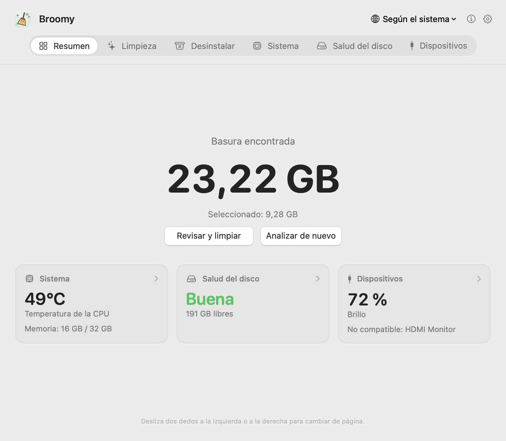
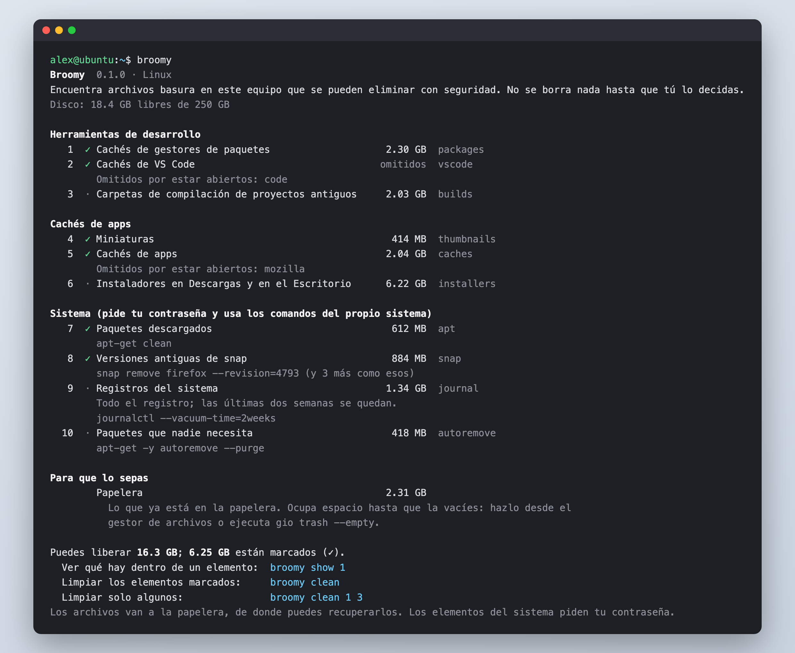
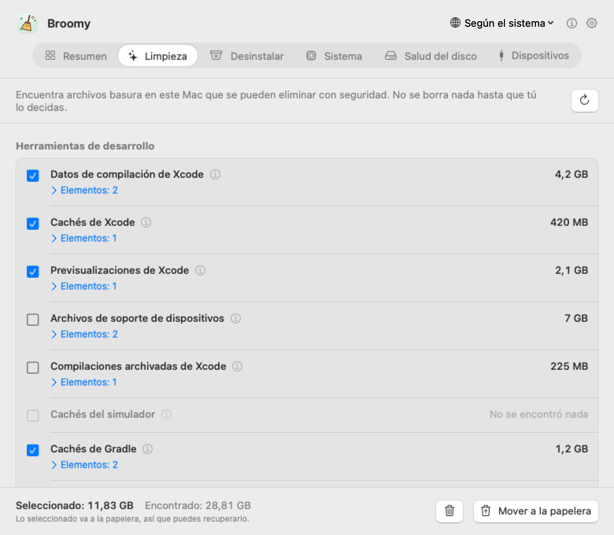
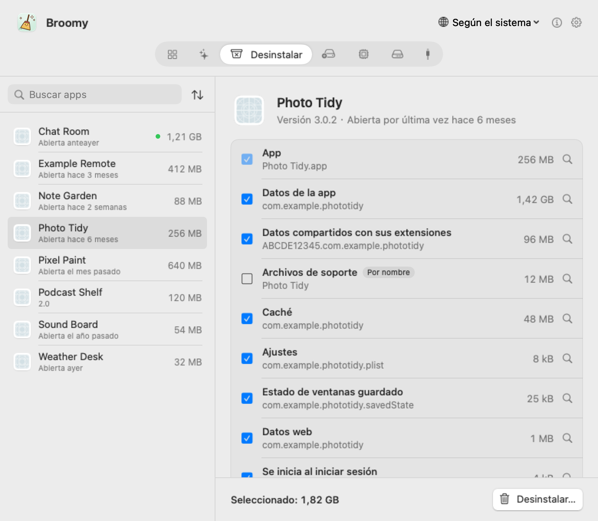
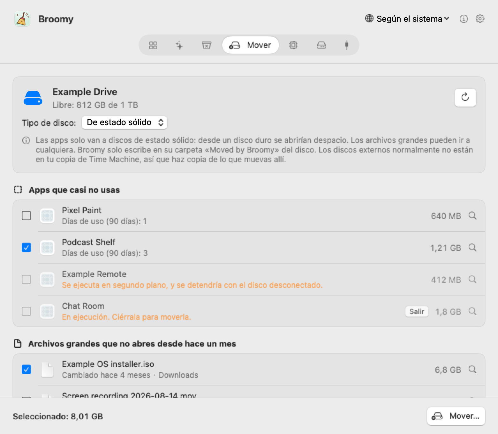
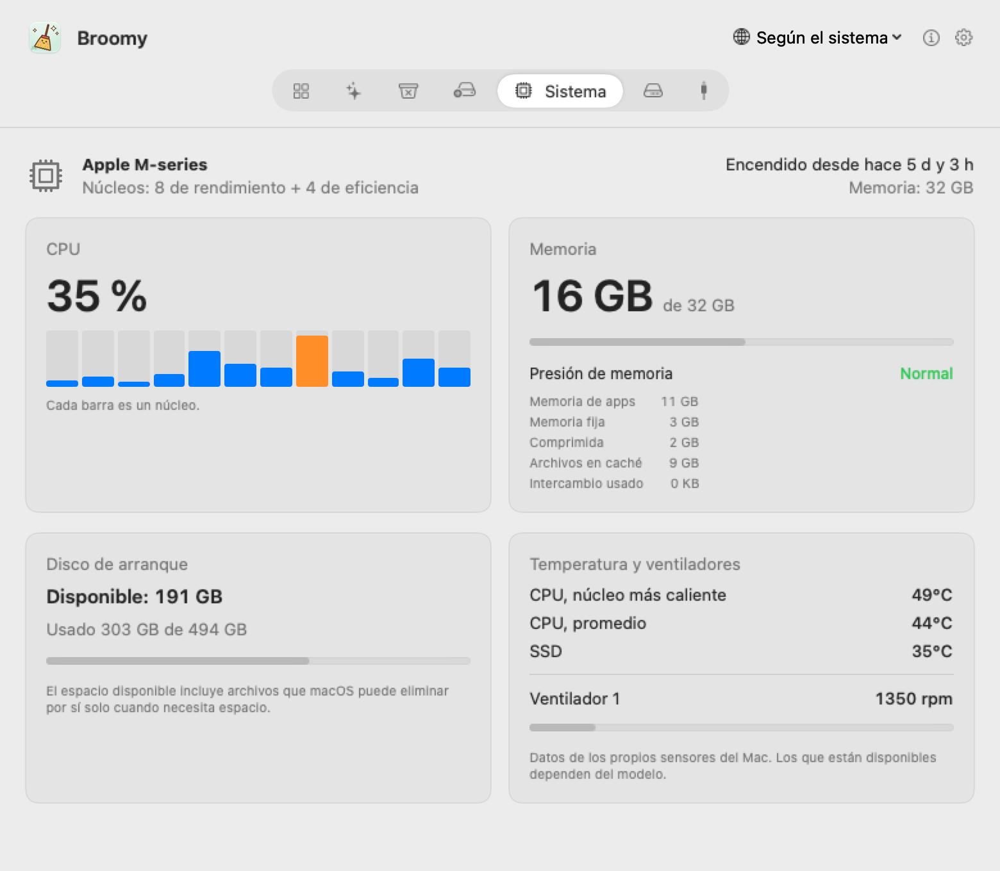
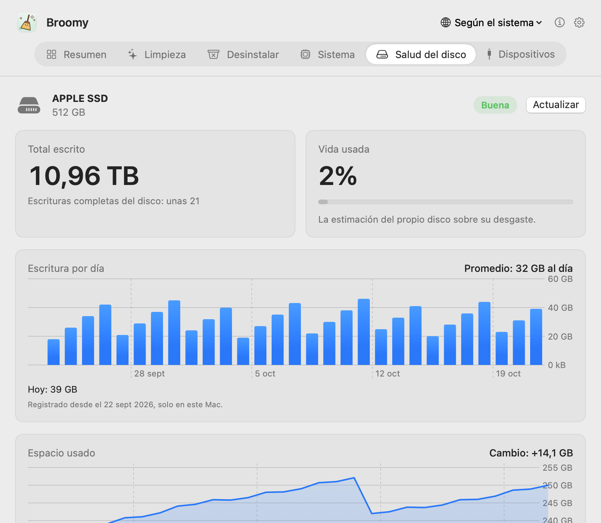
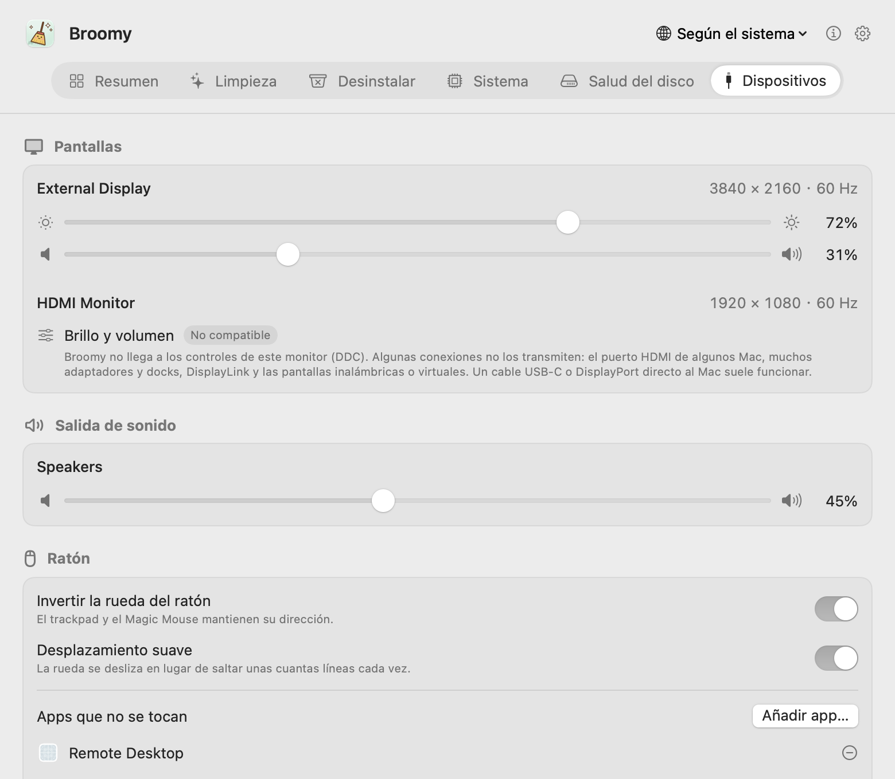

# Broomy

[English](README.md) · [简体中文](README.zh-CN.md) · [繁體中文](README.zh-TW.md) · [日本語](README.ja.md) · [한국어](README.ko.md) · **Español** · [Français](README.fr.md)

Un limpiador pequeño y honesto para tu Mac. Broomy encuentra lo que se puede borrar sin riesgo, desinstala apps junto con todo lo que dejan atrás y vigila la temperatura, la salud del disco y las pantallas de tu Mac. No borra nada hasta que tú lo decides, y todo va primero a la papelera. Gratis, sin anuncios y sin conectarse nunca a internet.

  

## Descarga

**[Broomy 1.2](https://github.com/techinfo-apps/Broomy/releases/latest)**: macOS 14 o posterior, Apple silicon o Intel. Abre el .dmg y arrastra Broomy a Aplicaciones.

Broomy todavía no está notarizado por Apple, así que macOS lo detiene la primera vez. En macOS 14: **clic secundario en Broomy → Abrir → Abrir**. En macOS 15 y posteriores: ábrelo una vez y luego ve a **Ajustes del Sistema → Privacidad y seguridad**, desplázate hacia abajo y haz clic en **Abrir igualmente** junto a Broomy.

Descarga Broomy solo desde las [Releases](https://github.com/techinfo-apps/Broomy/releases) de esta página o desde el sitio oficial https://techinfo-apps.github.io/. La página de Releases muestra el SHA-256 de cada archivo, para que puedas comprobar que la descarga no se ha modificado.

Novedades de cada versión: [historial de versiones](CHANGELOG.es.md).

### Linux

**[Broomy para Linux 0.1.0](https://github.com/techinfo-apps/Broomy/releases/tag/linux-v0.1.0)** es un solo comando, `broomy`, para la terminal. Funciona en cualquier Linux de 64 bits (x86_64 o ARM) sin instalar nada más.

Ubuntu, Debian y derivadas:

    wget https://github.com/techinfo-apps/Broomy/releases/download/linux-v0.1.0/broomy_0.1.0_amd64.deb
    sudo apt install ./broomy_0.1.0_amd64.deb
    broomy

(En un ordenador ARM, usa `broomy_0.1.0_arm64.deb`.) Cualquier otro Linux: descarga `broomy-0.1.0-linux-amd64` (o `-arm64`), dale `chmod +x` y ejecútalo.

`broomy` solo mira y enumera: cachés, carpetas de compilación de proyectos antiguos, instaladores en Descargas, versiones antiguas de snap, paquetes descargados y registros. `broomy show 3` muestra qué hay dentro de un elemento y `broomy clean` limpia los elementos marcados con ✓ después de preguntarte. Tus archivos van a la papelera, desde donde el gestor de archivos puede recuperarlos; los elementos del sistema usan los comandos del propio sistema y te piden la contraseña. Nunca se conecta a internet.

## Una página por función

Desliza dos dedos a la izquierda o a la derecha, haz clic en la barra de arriba o pulsa ⌘1…⌘7.

### Limpieza

Encuentra la basura que se puede borrar sin riesgo y te muestra exactamente qué es antes de mover nada.

- **Herramientas de desarrollo**: datos de compilación de Xcode, cachés, archivos de soporte de dispositivos, archivos y simuladores; descargas de Gradle y Homebrew; las cachés de pip, npm, pnpm, Yarn, Bun, CocoaPods, Swift Package Manager, Go y Cargo; y las carpetas de compilación (node_modules, .build, target, dist, build de Gradle) de proyectos que nadie ha cambiado en 30 días, nunca nada que esté controlado por git.
- **Cachés y registros de apps**, e instaladores olvidados en Descargas o en el Escritorio.
- **Restos de apps eliminadas**: ítems de inicio y servicios en segundo plano cuya app ya no está, que macOS intenta arrancar una y otra vez. Para quitar los que están en carpetas del sistema, se te pedirá la contraseña una sola vez, en el propio diálogo de macOS.

Lo que merece una segunda mirada (archivos de soporte de dispositivos, archivos, simuladores, instaladores, carpetas de compilación antiguas) empieza sin marcar.

  

### Desinstalar

Quita una app junto con su contenedor, cachés, ajustes, archivos de soporte, estado de ventanas guardado, datos web e ítems de inicio, cada uno con su tamaño. Los archivos se reconocen por el identificador de la app (y por los de las apps auxiliares que contiene); las carpetas que solo comparten su nombre se muestran, pero sin marcar. Las apps de Apple no aparecen, una app abierta hay que cerrarla antes, los archivos que comparte otra app no se tocan y, si la app en sí no se puede mover, no se toca nada más.

  

### Mover a un disco externo

Las apps que casi no usas y los archivos grandes que no abres desde hace un mes pueden vivir en un disco externo y volver cuando quieras. Broomy muestra las apps de 100 MB o más, con los días que has usado cada una en los últimos 90, y los archivos de 500 MB o más de Descargas, Escritorio, Documentos y Películas que llevan 30 días sin abrirse ni modificarse. No se mueve nada hasta que lo marcas y confirmas la lista.

Cada elemento se copia a una carpeta «Moved by Broomy» del disco y se comprueba con el original (archivos, tamaños y contenido, y también la firma en el caso de las apps). Solo entonces el original va a la papelera; una app deja un enlace en su sitio, así que se abre como antes (si estaba en el Dock, vuelve a arrastrarla allí). Si algún paso falla, la copia se elimina y el original se queda donde estaba. **Devolver** hace lo mismo en sentido contrario.

Las apps solo van a discos de estado sólido: desde un disco duro se abrirían despacio, así que los discos duros solo reciben archivos. Cuando un disco no indica de qué tipo es, eliges tú. El disco tiene que estar formateado como APFS o Mac OS Extended. Las apps de la App Store o de un instalador, las que se ejecutan en segundo plano y las que están abiertas se quedan donde están, cada una con su motivo. La primera vez que muevas una app, macOS puede pedirte que permitas Broomy en Gestión de apps, dentro de Ajustes del Sistema. Los discos externos normalmente no están en tu copia de Time Machine, y el espacio se libera cuando vacías la papelera.

  

### Sistema y salud del disco

Uso de la CPU por núcleo, memoria y presión de memoria, espacio del disco de arranque, temperaturas de la CPU y del SSD, velocidad de los ventiladores. Del SSD interno: cuánto se ha escrito, cuánto desgaste estima el propio disco y sus recuentos de errores, leídos directamente del disco, con las escrituras por día y el espacio usado de los últimos 30 días.

  
  

### Dispositivos

Brillo y volumen de tus pantallas, también de monitores externos (por DDC). Cuando un monitor no se puede ajustar, Broomy te lo dice, te explica por qué y qué puedes probar. Además, el volumen de la salida de sonido, una rueda del ratón más cómoda (invertirla, desplazamiento suave) y tus discos externos y dispositivos USB y Thunderbolt.

  

### En la barra de menús

Si quieres, Broomy se queda en la barra de menús: el tamaño de la basura o la temperatura de la CPU junto a una pequeña escoba, y un sol que abre el brillo y el volumen con un clic.

## Privacidad

- **Nunca se conecta a internet.** Broomy no tiene código de red; los únicos enlaces (esta página, la dirección de correo) se abren en tu navegador o en tu app de correo cuando haces clic.
- No recoge ni envía nada a ningún sitio. Su historial (escrituras por día, espacio usado) se queda en este Mac, y también el registro de qué apps abres cada día, que está desactivado salvo que lo actives en Ajustes.
- En un disco externo solo trabaja en su propia carpeta «Moved by Broomy», y solo después de que confirmes qué se mueve. Nunca muestra números de serie.
- Todo lo que quita va a la papelera, así que puedes recuperarlo hasta que la vacíes.

## Idiomas

English, 简体中文, 繁體中文, 日本語, 한국어, Español, Français, Русский, हिन्दी. Si ves algo mal traducido, escríbenos a la dirección de abajo.

## Comentarios

techinfor404@gmail.com, o abre un issue aquí.

Broomy es gratis. El código fuente no se publica.

---

**Siempre gratis. Nunca anuncios.** Solo apps y juegos pequeños y bonitos. Gratis, sin anuncios y privados: tus datos se quedan en tus propios dispositivos.

Contacto: techinfor404@gmail.com · Web: https://techinfo-apps.github.io/

 Invita al desarrollador a un café

Es voluntario: funciona igual de todos modos. Cada taza se convierte en la próxima actualización.

