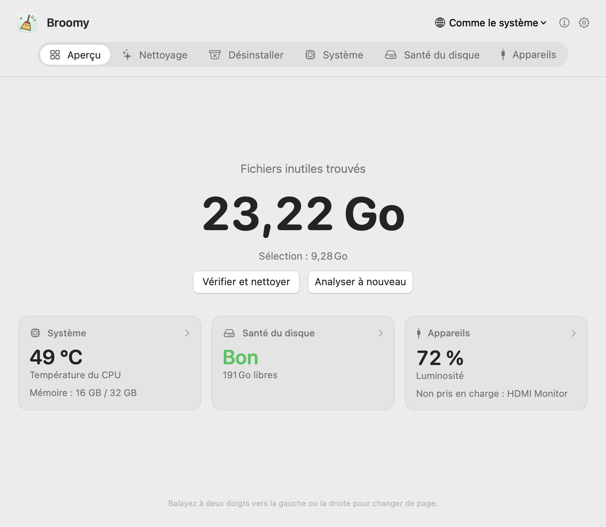
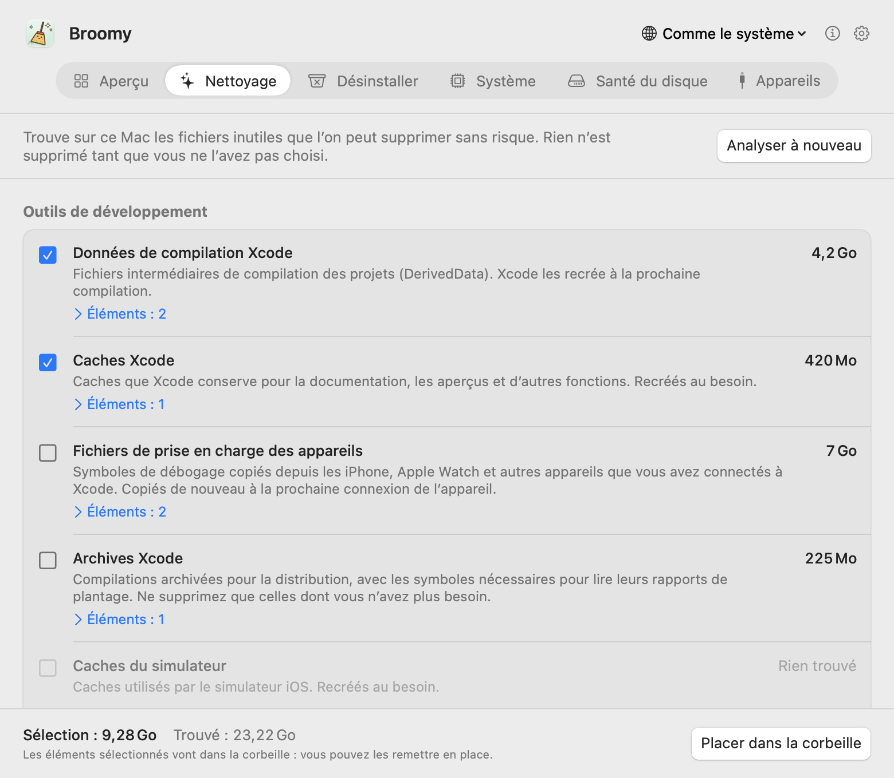
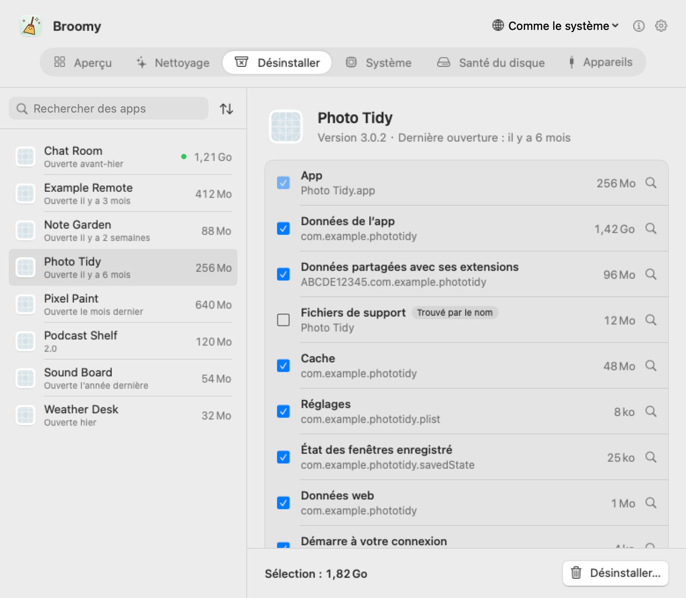
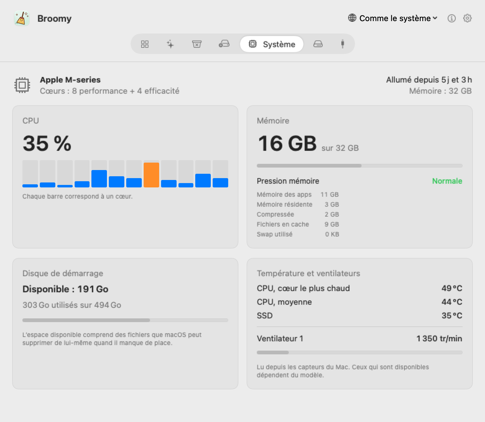
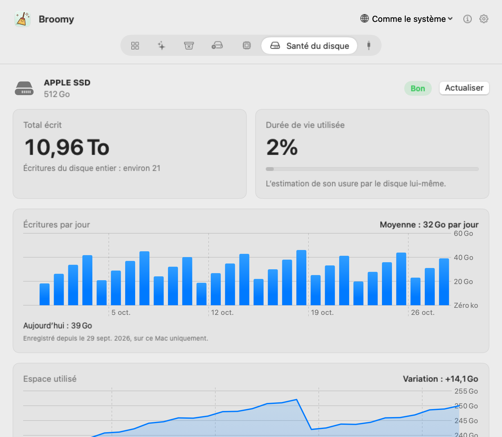
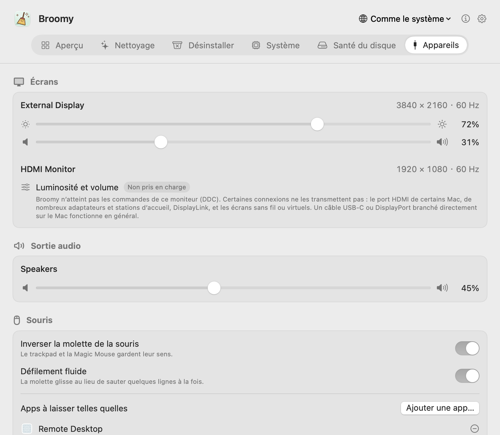

# Broomy

[English](README.md) · [简体中文](README.zh-CN.md) · [繁體中文](README.zh-TW.md) · [日本語](README.ja.md) · [한국어](README.ko.md) · [Español](README.es.md) · **Français**

Un petit nettoyeur honnête pour votre Mac. Broomy trouve ce que l’on peut supprimer sans risque, désinstalle les apps avec tout ce qu’elles laissent derrière elles et garde un œil sur la température, la santé du disque et les écrans de votre Mac. Rien n’est supprimé tant que vous ne l’avez pas choisi, et tout passe d’abord par la corbeille. Gratuit, sans publicité, et jamais connecté à internet.

  

## Téléchargement

**[Broomy 1.0](https://github.com/techinfo-apps/Broomy/releases/latest)** : macOS 14 ou ultérieur, Apple silicon ou Intel. Ouvrez le .dmg et glissez Broomy dans Applications.

Broomy n’est pas encore notarié par Apple, donc macOS l’arrête la première fois. Sur macOS 14 : **clic droit sur Broomy → Ouvrir → Ouvrir**. Sur macOS 15 et ultérieur : ouvrez-le une fois, puis allez dans **Réglages Système → Confidentialité et sécurité**, faites défiler vers le bas et cliquez sur **Ouvrir quand même** à côté de Broomy.

Ne téléchargez Broomy que depuis les [Releases](https://github.com/techinfo-apps/Broomy/releases) de cette page ou le site officiel https://techinfo-apps.github.io/. La page des Releases indique le SHA-256 de chaque fichier, pour vérifier qu’un téléchargement n’a pas été modifié.

Les nouveautés de chaque version : [historique des versions](CHANGELOG.fr.md).

## Une page par fonction

Balayez à deux doigts vers la gauche ou la droite, cliquez sur la barre en haut, ou appuyez sur ⌘1…⌘6.

### Nettoyage

Trouve les fichiers inutiles que l’on peut supprimer sans risque et montre exactement ce que c’est avant de déplacer quoi que ce soit.

- **Outils de développement** : données de compilation Xcode, caches, fichiers de prise en charge des appareils, archives et simulateurs ; téléchargements de Gradle et Homebrew ; caches de pip, npm, pnpm, Yarn, Bun, CocoaPods, Swift Package Manager, Go et Cargo ; et les dossiers de compilation (node_modules, .build, target, dist, build de Gradle) des projets que personne n’a modifiés depuis 30 jours, jamais rien de ce qui est suivi par git.
- **Caches et journaux des apps**, et programmes d’installation oubliés dans Téléchargements ou sur le Bureau.
- **Laissé par des apps supprimées** : éléments d’ouverture et services d’arrière-plan dont l’app n’existe plus, que macOS essaie de lancer encore et encore. Supprimer ceux des dossiers système demande votre mot de passe, une seule fois, dans la boîte de dialogue de macOS.

Ce qui mérite un second regard (fichiers de prise en charge des appareils, archives, simulateurs, programmes d’installation, anciens dossiers de compilation) n’est pas coché au départ.

  

### Désinstaller

Supprime une app avec son conteneur, ses caches, ses réglages, ses fichiers de support, l’état de ses fenêtres, ses données web et ses éléments d’ouverture, chacun avec sa taille. Les fichiers sont reconnus par l’identifiant de l’app (et ceux des apps auxiliaires qu’elle contient) ; les dossiers qui portent seulement son nom sont affichés, mais pas cochés. Les apps d’Apple ne sont pas listées, une app ouverte doit d’abord être quittée, les fichiers partagés avec une autre app ne sont pas touchés et, si l’app elle-même ne peut pas être déplacée, rien d’autre ne l’est.

  

### Système et santé du disque

Utilisation du CPU par cœur, mémoire et pression mémoire, espace du disque de démarrage, températures du CPU et du SSD, vitesse des ventilateurs. Pour le SSD interne : la quantité écrite, l’usure estimée par le disque lui-même et ses compteurs d’erreurs, lus directement sur le disque, avec les écritures par jour et l’espace utilisé sur les 30 derniers jours.

  
  

### Appareils

Luminosité et volume de vos écrans, moniteurs externes compris (par DDC). Quand un moniteur ne peut pas être réglé, Broomy vous le signale, explique pourquoi et indique ce que vous pouvez essayer. Aussi : le volume de la sortie audio, une molette de souris plus agréable (inversée, défilement fluide), vos disques externes et vos appareils USB et Thunderbolt.

  

### Dans la barre des menus

Si vous le souhaitez, Broomy reste dans la barre des menus : la taille des fichiers inutiles ou la température du CPU à côté d’un petit balai, et un soleil qui ouvre la luminosité et le volume en un clic.

## Confidentialité

- **Jamais connecté à internet.** Broomy n’a aucun code réseau ; les seuls liens (cette page, l’adresse e-mail) s’ouvrent dans votre navigateur ou votre app de messagerie quand vous cliquez dessus.
- Rien n’est collecté ni envoyé nulle part. Son historique (écritures par jour, espace utilisé) reste sur ce Mac.
- Il ne lit jamais le contenu des disques externes et n’affiche jamais de numéro de série.
- Tout ce qu’il supprime va dans la corbeille : vous pouvez le remettre en place tant qu’elle n’est pas vidée.

## Langues

English, 简体中文, 繁體中文, 日本語, 한국어, Español, Français, Русский, हिन्दी. Une traduction maladroite ? Écrivez-nous à l’adresse ci-dessous.

## Retours

sublueai@gmail.com, ou ouvrez une issue ici.

Broomy est gratuit. Le code source n’est pas publié.

---

**Toujours gratuit. Jamais de publicité.** Uniquement de petites applis et de petits jeux, simples et soignés. Gratuits, sans publicité, respectueux de votre vie privée : vos données restent sur vos propres appareils.

Contact : sublueai@gmail.com · Site : https://techinfo-apps.github.io/

 Offrir un café au développeur

C’est facultatif : tout fonctionne pareil. Chaque tasse devient la prochaine mise à jour.

