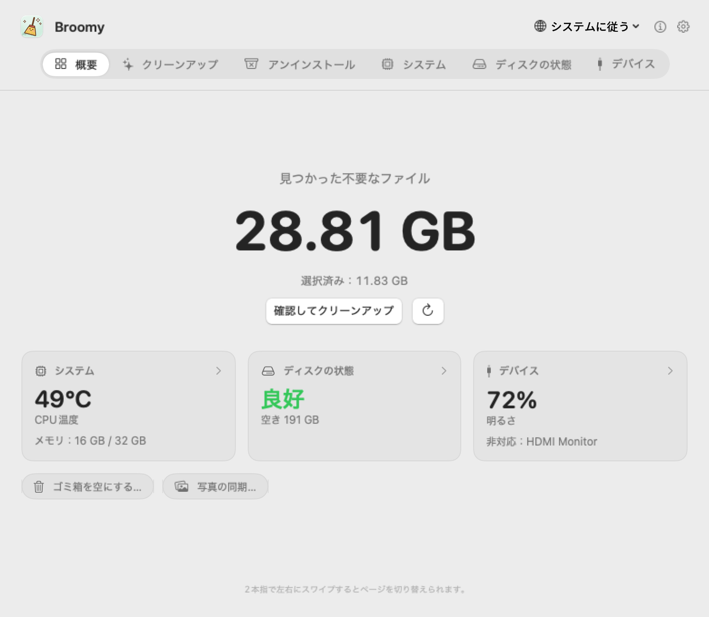
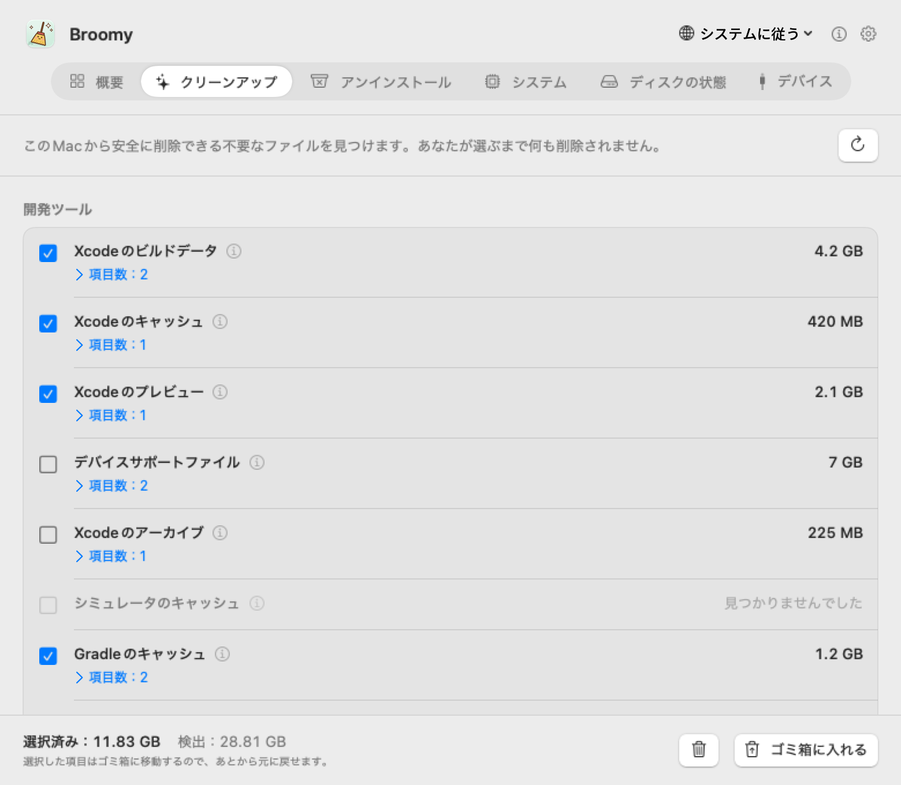
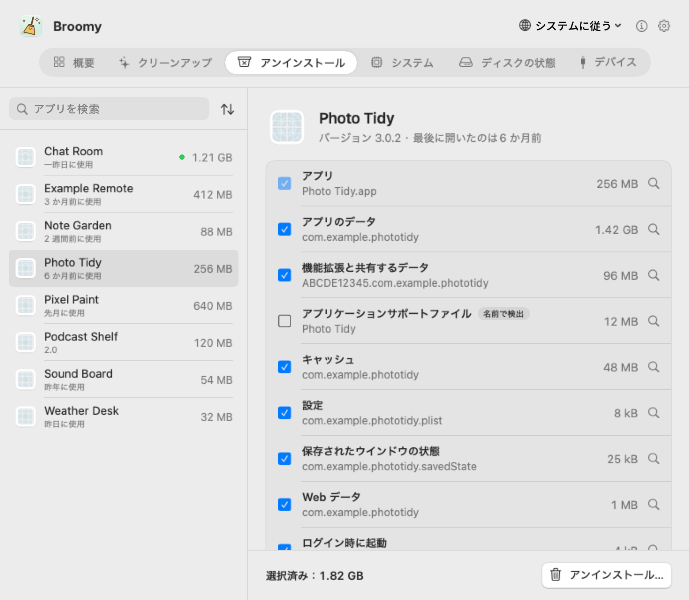
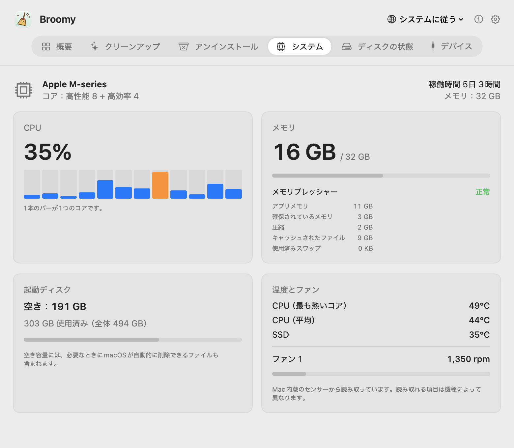
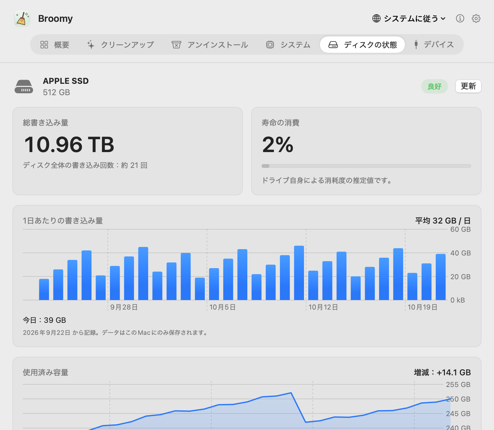
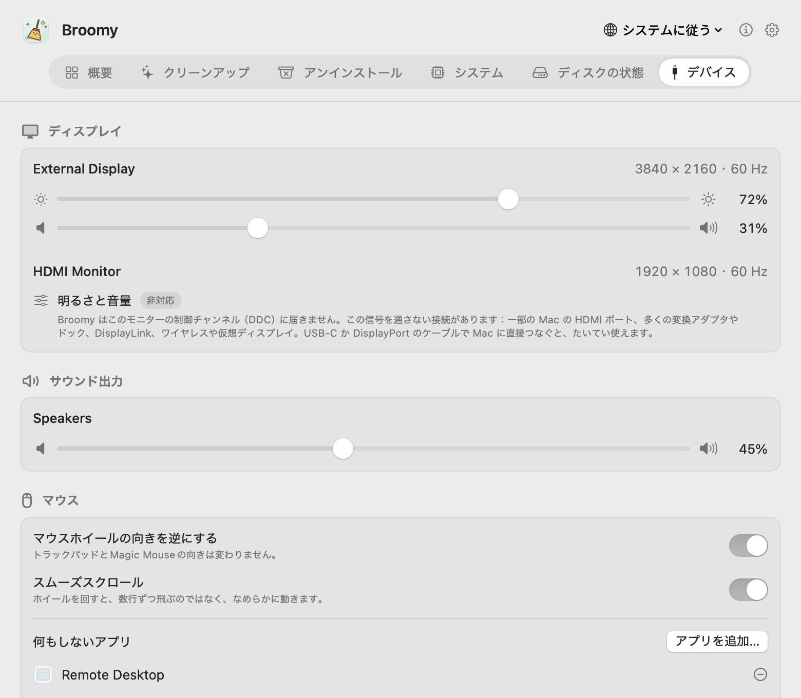

# Broomy

[English](README.md) · [简体中文](README.zh-CN.md) · [繁體中文](README.zh-TW.md) · **日本語** · [한국어](README.ko.md) · [Español](README.es.md) · [Français](README.fr.md)

小さくて正直な Mac のクリーナーです。安全に消せるものを見つけ、アプリをアンインストールするときは残していくものもまとめて片づけ、Mac の温度、ディスクの状態、ディスプレイも見守ります。あなたが選ぶまで何も削除せず、削除するものもまずゴミ箱へ。無料、広告なし、インターネットには一切接続しません。

  

## ダウンロード

**[Broomy 1.1](https://github.com/techinfo-apps/Broomy/releases/latest)**：macOS 14 以降、Apple シリコンと Intel の両方に対応。.dmg を開いて、Broomy を「アプリケーション」にドラッグしてください。

このアプリはまだ Apple の公証を受けていないため、初回は macOS に止められます。macOS 14：**Broomy を右クリック → 開く → 開く**。macOS 15 以降：一度開いてから **システム設定 → プライバシーとセキュリティ** を下にスクロールし、Broomy の横の **このまま開く** をクリックしてください。

Broomy はこのページの [Releases](https://github.com/techinfo-apps/Broomy/releases) か公式サイト https://techinfo-apps.github.io/ からだけダウンロードしてください。Releases ページには各ファイルの SHA-256 が載っているので、ダウンロードしたものが改変されていないか確かめられます。

各バージョンの変更点：[バージョン履歴](CHANGELOG.ja.md)。

## 1 ページに 1 機能

2 本指で左右にスワイプ、上のバーをクリック、または ⌘1…⌘6 でページを切り替えます。

### クリーンアップ

安全に消せる不要なファイルを見つけ、動かす前にそれぞれが何なのかをはっきり示します。

- **開発ツール**：Xcode のビルドデータ、キャッシュ、デバイスサポートファイル、アーカイブ、シミュレータ。Gradle と Homebrew のダウンロード。pip、npm、pnpm、Yarn、Bun、CocoaPods、Swift Package Manager、Go、Cargo のキャッシュ。30 日間だれも変更していないプロジェクトのビルドフォルダ（node_modules、.build、target、dist、Gradle の build）。git で管理されているものには触れません。
- **アプリのキャッシュとログ**、「ダウンロード」やデスクトップに残ったインストーラ。
- **削除したアプリの残りもの**：アプリはもうないのに残っているログイン項目やバックグラウンドサービス。macOS は何度も起動しようとし続けます。システムフォルダにあるものは、削除のときに macOS 自身のダイアログでパスワードを一度だけ尋ねます。

確認したほうがよいもの（デバイスサポートファイル、アーカイブ、シミュレータ、インストーラ、古いビルドフォルダ）は最初はチェックが入っていません。

  

### アンインストール

アプリと一緒に、そのコンテナ、キャッシュ、設定、アプリケーションサポートファイル、ウインドウの状態、Web データ、ログイン項目をまとめて移動します。どれもサイズ付きで表示します。探すのはアプリの識別子（と中にあるヘルパーの識別子）で。名前が同じだけのフォルダは表示しますがチェックは入れません。Apple のアプリは表示せず、実行中のアプリは先に終了しておく必要があります。ほかのアプリと共有しているファイルには触れず、アプリ本体を移動できなかったときはほかのものも一切動かしません。

  

### システムとディスクの状態

コアごとの CPU 使用率、メモリとメモリプレッシャー、起動ディスクの空き、CPU と SSD の温度、ファンの回転数。内蔵 SSD については、書き込み総量、ディスク自身が見積もる消耗度、エラー数をディスクから直接読み取り、直近 30 日の 1 日あたりの書き込み量と使用量の推移も表示します。

  
  

### デバイス

ディスプレイの明るさと音量を調整できます。外部モニタも対応（DDC 経由）。調整できないモニタは、非対応であること、その理由、試せることをはっきり伝えます。ほかにサウンド出力の音量、使いやすいマウスホイール（向きの反転、なめらかなスクロール）、外部ディスク、USB と Thunderbolt デバイス。

  

### メニューバー

お好みで、Broomy をメニューバーに常駐させられます。小さなほうきの横に不要なファイルのサイズか CPU 温度を表示し、太陽のアイコンをクリックすれば明るさと音量をすぐ調整できます。

## プライバシー

- **インターネットには一切接続しません。** Broomy にはネットワークのコードがありません。リンク（このページ、メールアドレス）は、クリックしたときにブラウザかメールで開くだけです。
- 何も収集せず、どこにも送りません。記録（1 日あたりの書き込み、使用量）はこの Mac の中だけに残ります。
- 外部ディスクの中身は読まず、シリアル番号も表示しません。
- 削除するものはすべてゴミ箱へ。空にするまではいつでも元に戻せます。

## 言語

English、简体中文、繁體中文、日本語、한국어、Español、Français、Русский、हिन्दी。翻訳の誤りは、下のアドレスまでお知らせいただけるとうれしいです。

## フィードバック

sublueai@gmail.com、またはここで issue を作成してください。

Broomy は無料で使えます。ソースコードは公開していません。

---

**ずっと無料、ずっと広告なし。** 小さくて美しいアプリと、小さなゲームだけを。無料、広告なし、プライバシーを大切に——データはあなたのデバイスの中だけに。

連絡先：sublueai@gmail.com · 公式サイト：https://techinfo-apps.github.io/

 作者にコーヒーをおごる

任意です。おごらなくても同じように使えます。一杯ごとに、次のアップデートになります。

