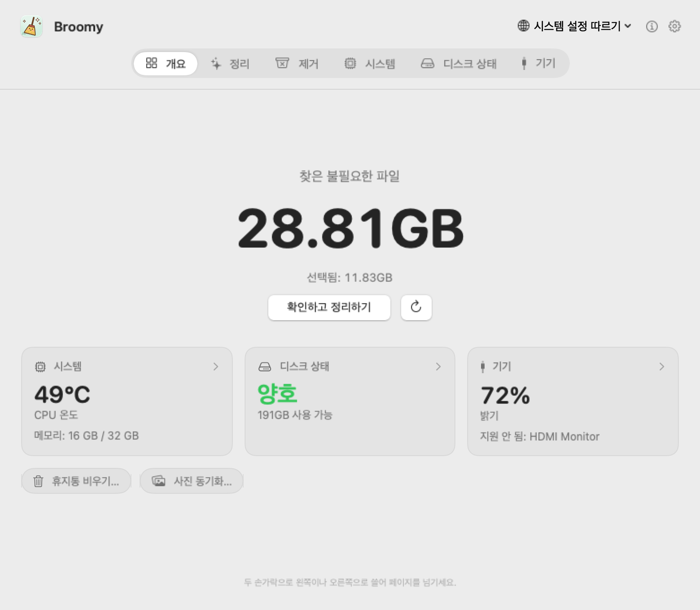
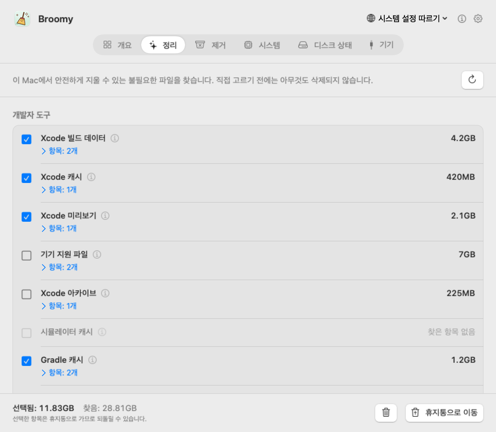
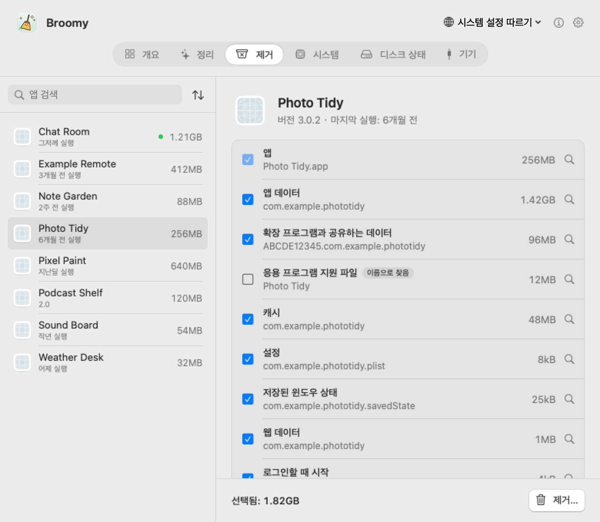
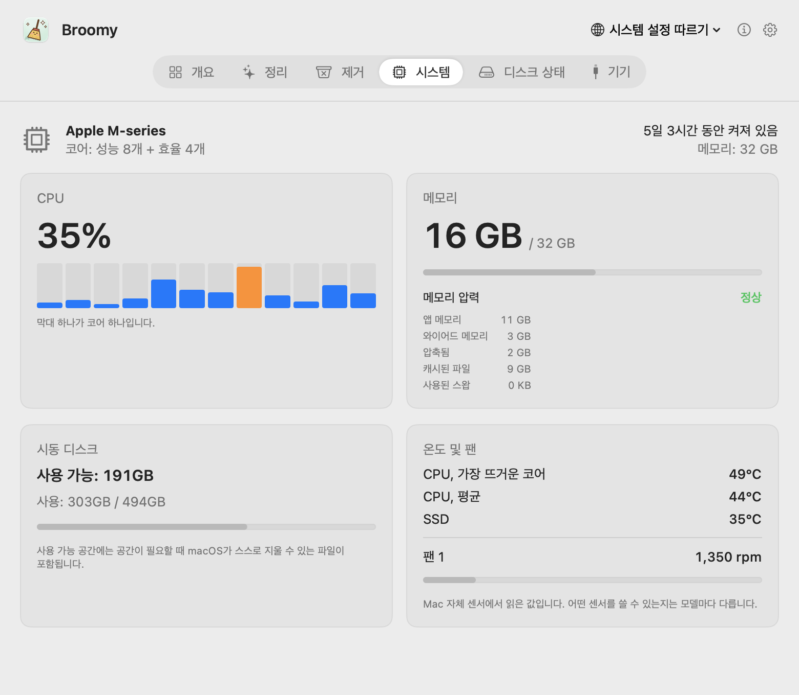
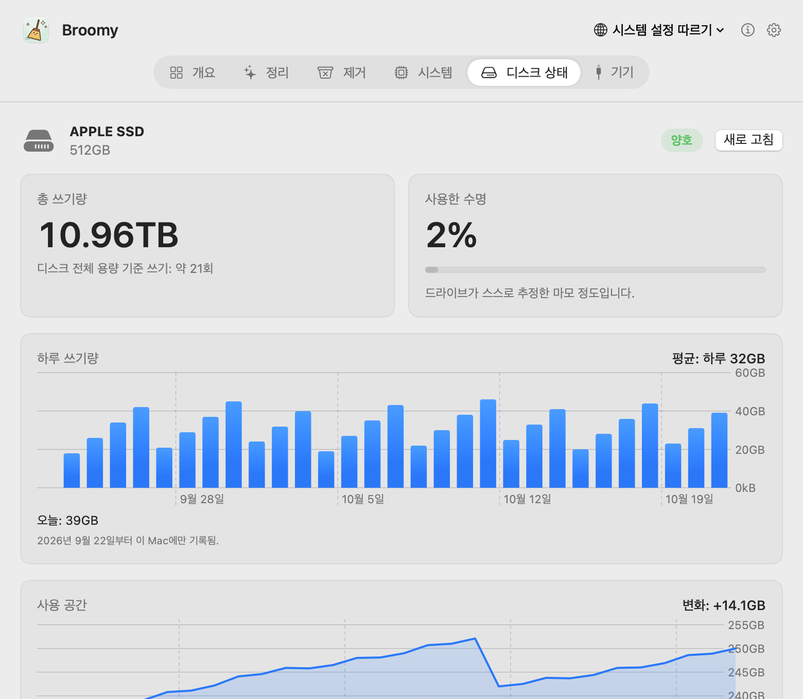
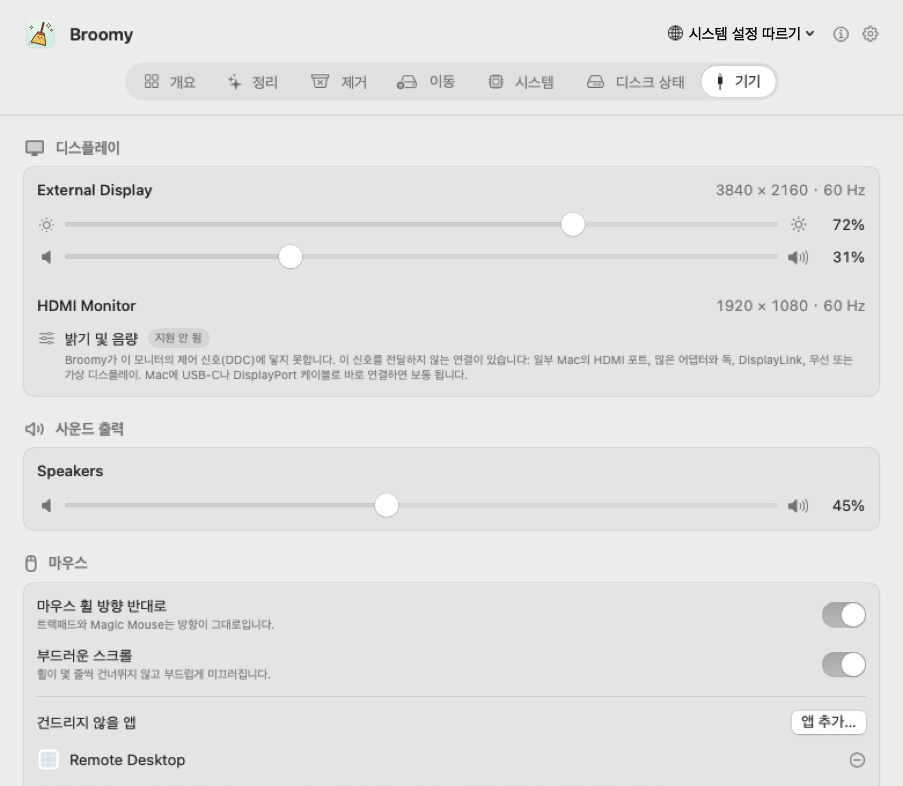

# Broomy

[English](README.md) · [简体中文](README.zh-CN.md) · [繁體中文](README.zh-TW.md) · [日本語](README.ja.md) · **한국어** · [Español](README.es.md) · [Français](README.fr.md)

작고 정직한 Mac 정리 도구입니다. Broomy는 안전하게 지울 수 있는 것을 찾고, 앱을 제거할 때 남기고 가는 것까지 함께 치우며, Mac의 온도와 디스크 상태, 디스플레이도 살펴봅니다. 직접 고르기 전에는 아무것도 지우지 않고, 지우는 것은 모두 먼저 휴지통으로 갑니다. 무료이고, 광고가 없으며, 인터넷에 연결하지 않습니다.

  

## 다운로드

**[Broomy 1.1](https://github.com/techinfo-apps/Broomy/releases/latest)**: macOS 14 이상, Apple 실리콘과 Intel 모두 지원합니다. .dmg를 열고 Broomy를 응용 프로그램 폴더로 끌어다 놓으세요.

아직 Apple의 공증을 받지 않아 처음 열 때 macOS가 막습니다. macOS 14: **Broomy를 오른쪽 클릭 → 열기 → 열기**. macOS 15 이상: 한 번 열어 본 뒤 **시스템 설정 → 개인정보 보호 및 보안**에서 아래로 스크롤해 Broomy 옆의 **확인 없이 열기**를 클릭하세요.

Broomy는 이 페이지의 [Releases](https://github.com/techinfo-apps/Broomy/releases)나 공식 사이트 https://techinfo-apps.github.io/ 에서만 내려받으세요. Releases 페이지에 파일마다 SHA-256이 있어서, 내려받은 파일이 바뀌지 않았는지 확인할 수 있습니다.

버전마다 달라진 점: [버전 기록](CHANGELOG.ko.md).

## 기능마다 한 페이지

두 손가락으로 왼쪽이나 오른쪽으로 쓸거나, 위쪽 막대를 클릭하거나, ⌘1…⌘6을 누르세요.

### 정리

안전하게 지울 수 있는 것을 찾고, 옮기기 전에 그것이 무엇인지 정확히 보여 줍니다.

- **개발자 도구**: Xcode 빌드 데이터, 캐시, 기기 지원 파일, 아카이브, 시뮬레이터. Gradle과 Homebrew의 다운로드 캐시. pip, npm, pnpm, Yarn, Bun, CocoaPods, Swift Package Manager, Go, Cargo의 캐시. 30일 동안 아무도 바꾸지 않은 프로젝트의 빌드 폴더(node_modules, .build, target, dist, Gradle의 build)도 찾습니다. git이 추적하는 것은 건드리지 않습니다.
- **앱 캐시와 로그**, 다운로드 폴더나 데스크탑에 남은 설치 파일.
- **삭제한 앱이 남긴 것**: 앱은 없는데 남아 있는 로그인 항목과 백그라운드 서비스로, macOS가 계속 실행하려고 합니다. 시스템 폴더에 있는 것을 지울 때는 macOS 자체 대화상자에서 암호를 한 번 묻습니다.

한 번 더 볼 만한 것(기기 지원 파일, 아카이브, 시뮬레이터, 설치 파일, 오래된 빌드 폴더)은 처음에 체크하지 않습니다.

  

### 제거

앱을 그 앱의 컨테이너, 캐시, 설정, 응용 프로그램 지원 파일, 저장된 윈도우 상태, 웹 데이터, 로그인 항목과 함께 휴지통으로 옮기며, 각각의 크기를 보여 줍니다. 앱의 식별자(와 앱 안에 들어 있는 헬퍼 앱의 식별자)로 찾습니다. 이름만 같은 폴더는 보여 주지만 체크하지 않습니다. Apple의 앱은 목록에 없고, 실행 중인 앱은 먼저 종료해야 하며, 다른 앱과 함께 쓰는 파일은 건드리지 않습니다. 앱 자체를 옮길 수 없으면 다른 것도 전혀 건드리지 않습니다.

  

### 시스템과 디스크 상태

코어별 CPU 사용률, 메모리와 메모리 압력, 시동 디스크 공간, CPU와 SSD 온도, 팬 속도. 내장 SSD는 지금까지 쓴 양, 드라이브가 스스로 추정한 마모 정도, 오류 수를 드라이브에서 직접 읽고, 최근 30일의 하루 쓰기량과 사용 공간 변화도 보여 줍니다.

  
  

### 기기

디스플레이의 밝기와 음량을 조절합니다. 외장 모니터도 됩니다(DDC). 조절할 수 없는 모니터는 조절할 수 없다는 사실과 그 이유, 해 볼 수 있는 방법을 알려 줍니다. 사운드 출력 음량, 더 편한 마우스 휠(방향 반대로, 부드러운 스크롤), 외장 드라이브와 USB, Thunderbolt 기기도 볼 수 있습니다.

  

### 메뉴 막대

원하면 Broomy를 메뉴 막대에 둘 수 있습니다. 작은 빗자루 옆에 불필요한 파일 크기나 CPU 온도를 보여 주고, 태양 아이콘을 한 번 클릭하면 밝기와 음량을 바로 조절할 수 있습니다.

## 개인정보

- **인터넷에 연결하지 않습니다.** Broomy에는 네트워크 코드가 없습니다. 링크(이 페이지, 이메일 주소)는 클릭할 때 브라우저나 메일 앱에서 열릴 뿐입니다.
- 아무것도 수집하지 않고 어디에도 보내지 않습니다. 기록(하루 쓰기량, 사용 공간)은 이 Mac에만 남습니다.
- 외장 드라이브의 내용을 읽지 않고, 일련번호도 표시하지 않습니다.
- 지우는 것은 모두 휴지통으로 가므로, 비우기 전까지 언제든 되돌릴 수 있습니다.

## 언어

English, 简体中文, 繁體中文, 日本語, 한국어, Español, Français, Русский, हिन्दी. 번역이 어색한 곳이 있으면 아래 주소로 알려 주세요.

## 의견

sublueai@gmail.com, 또는 여기에서 issue를 열어 주세요.

Broomy는 무료로 쓸 수 있습니다. 소스 코드는 공개하지 않습니다.

---

**영원히 무료, 영원히 광고 없이.** 작고 아름다운 앱과 작은 게임만 만듭니다. 무료, 광고 없음, 당신의 프라이버시를 지킵니다 — 데이터는 당신의 기기 안에만 머뭅니다.

연락처: sublueai@gmail.com · 웹사이트: https://techinfo-apps.github.io/

 개발자에게 커피 한 잔

선택 사항이에요. 사지 않아도 똑같이 쓸 수 있어요. 커피 한 잔이 다음 업데이트가 됩니다.

