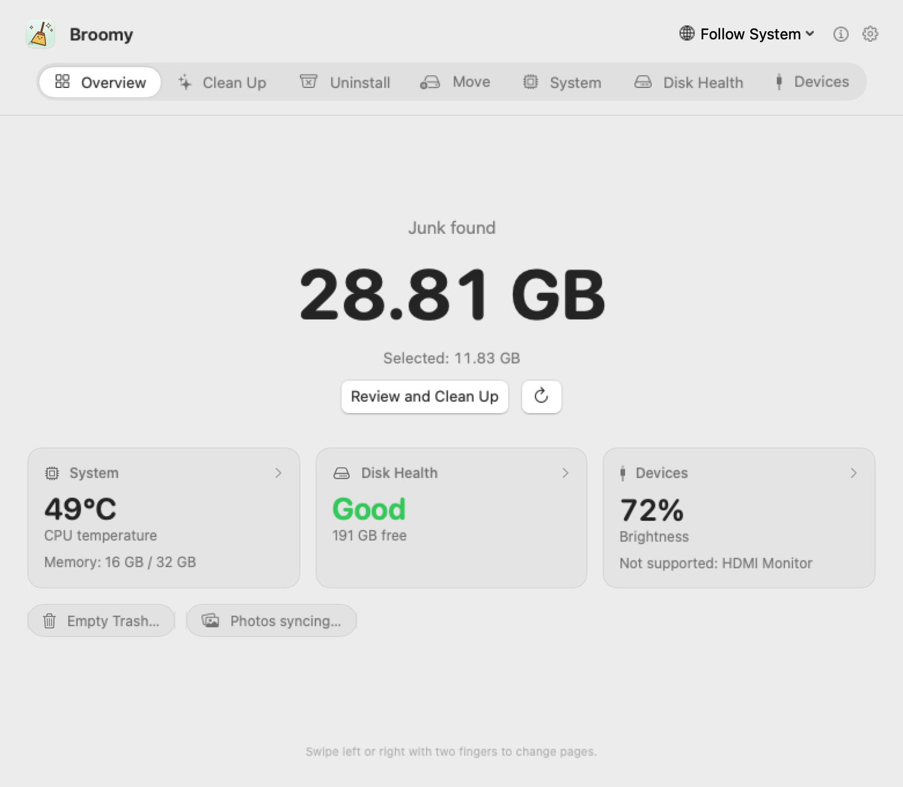
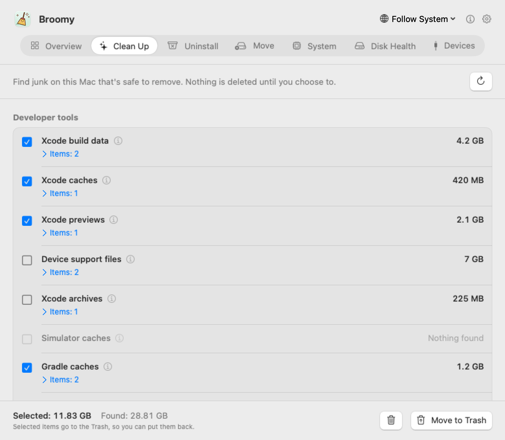
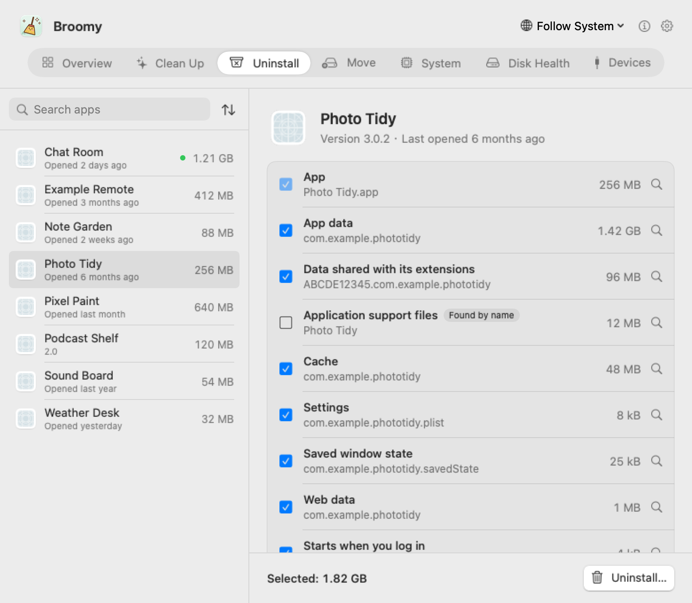
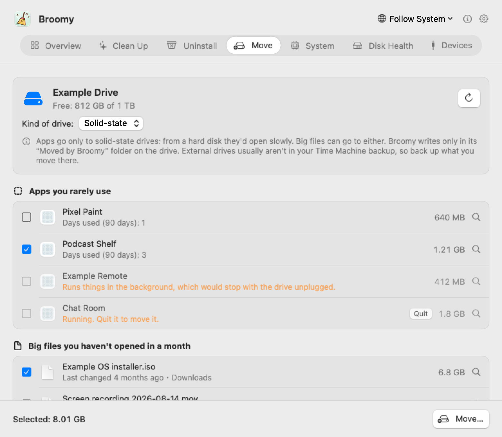
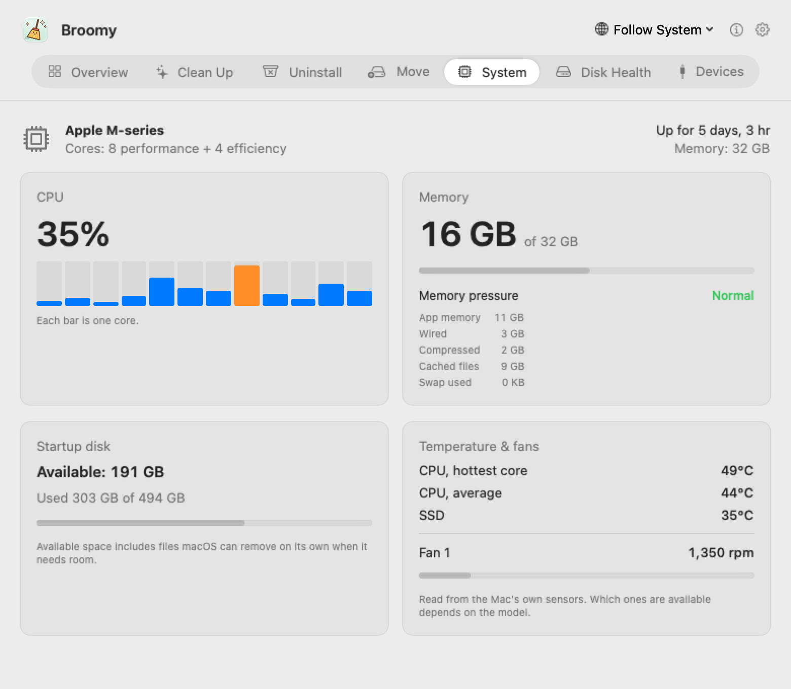
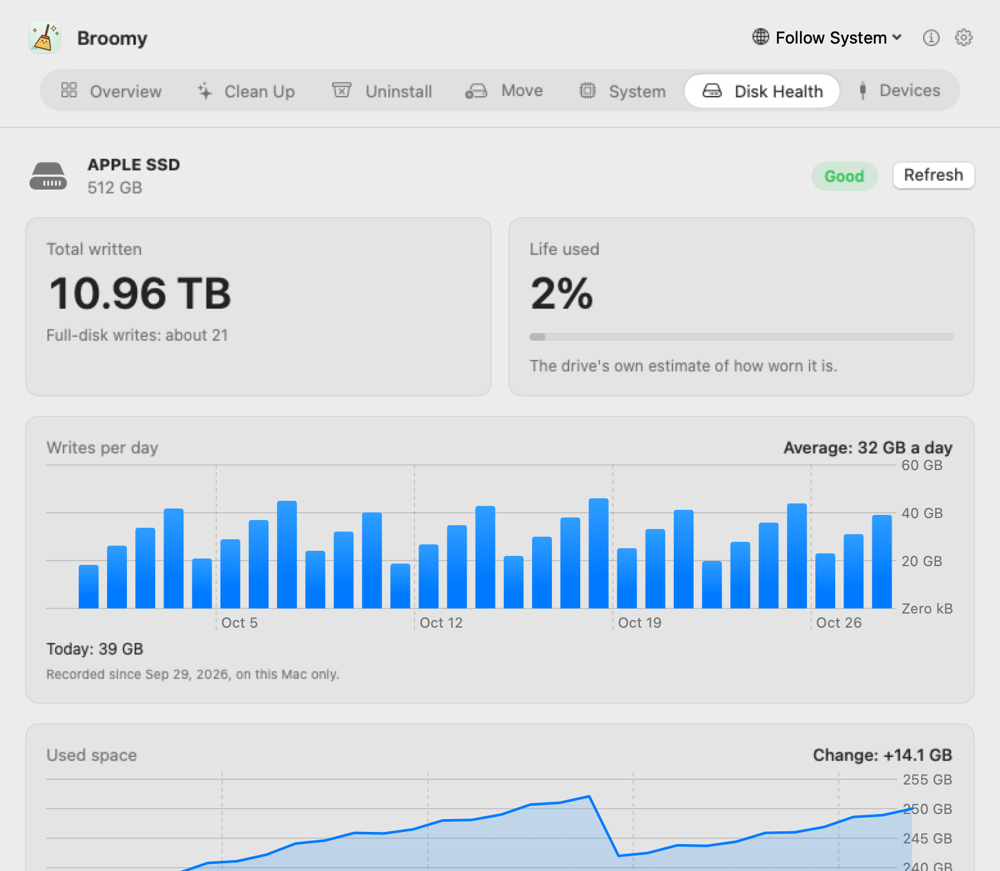
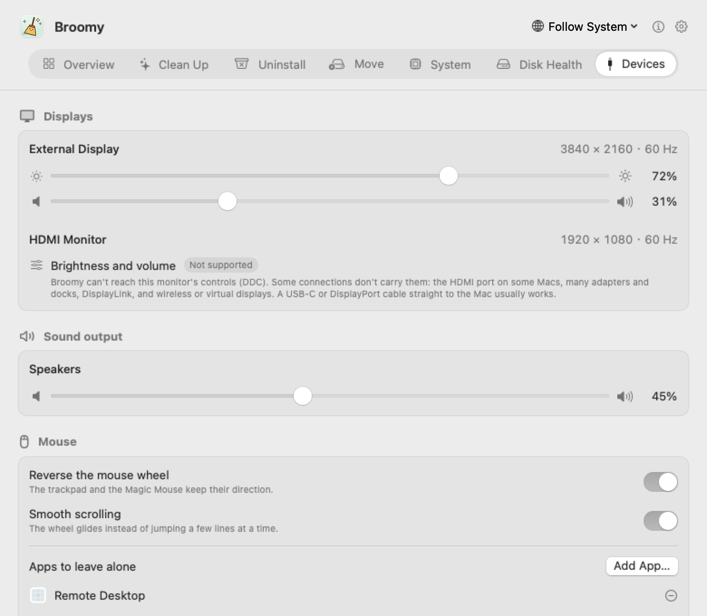

# Broomy

**English** · [简体中文](README.zh-CN.md) · [繁體中文](README.zh-TW.md) · [日本語](README.ja.md) · [한국어](README.ko.md) · [Español](README.es.md) · [Français](README.fr.md)

A small, honest cleaner for your Mac. Broomy finds what's safe to remove, uninstalls apps together with what they leave behind, and keeps an eye on your Mac's temperature, disk health and displays. Nothing is deleted until you choose to, and everything goes to the Trash first. Free, no ads, and it never connects to the internet.

  

## Download

**[Broomy 1.2](https://github.com/techinfo-apps/Broomy/releases/latest)**: macOS 14 or later, Apple silicon or Intel. Open the .dmg and drag Broomy to Applications.

Broomy isn't notarized by Apple yet, so macOS stops it the first time. On macOS 14: **right-click Broomy → Open → Open**. On macOS 15 and later: open it once, then go to **System Settings → Privacy & Security**, scroll down and click **Open Anyway** next to Broomy.

Download Broomy only from this page's [Releases](https://github.com/techinfo-apps/Broomy/releases) or the official site https://techinfo-apps.github.io/. The Releases page shows each file's SHA-256, so you can check a download wasn't changed.

What's new in each version: [Version history](CHANGELOG.md).

## One page per feature

Swipe left or right with two fingers, click the bar at the top, or press ⌘1…⌘7.

### Clean Up

Finds junk that's safe to remove and shows exactly what it is before anything moves.

- **Developer tools**: Xcode build data, caches, device support files, archives and simulators; Gradle and Homebrew downloads; the caches of pip, npm, pnpm, Yarn, Bun, CocoaPods, Swift Package Manager, Go and Cargo; and the build folders (node_modules, .build, target, dist, Gradle's build) of projects nobody has changed for 30 days, never anything git tracks.
- **App caches and logs**, and installers left in Downloads or on the Desktop.
- **Left behind by deleted apps**: login items and background services whose app is gone, which macOS keeps trying to start again and again. Removing those in system folders asks for your password, once, in macOS's own dialog.

Things worth a second look (device support files, archives, simulators, installers, old build folders) start unticked.

  

### Uninstall

Removes an app together with its container, caches, settings, application support files, saved window state, web data and login items, each shown with its size. Files are matched by the app's identifier (and those of the helpers inside it); folders that only carry its name are shown but not ticked. Apple's apps aren't listed, a running app has to be quit first, files another app shares are left alone, and if the app itself can't be moved, nothing else is touched.

  

### Move to an External Drive

Apps you rarely use and big files you haven't opened in a month can live on an external drive, and come back whenever you like. Broomy lists apps over 100 MB, with how many days you used each in the last 90, and files over 500 MB in Downloads, Desktop, Documents and Movies that haven't been opened or changed for 30 days. Nothing moves until you tick it and confirm the list.

Each one is copied into a “Moved by Broomy” folder on the drive and checked against the original (files, sizes and contents, and an app's signature too). Only then does the original go to the Trash; an app leaves a link in its old place, so it still opens as before (drag it to the Dock again if it was there). If any step fails, the copy is removed and the original stays where it was. **Move back** does the same the other way round.

Apps go only to solid-state drives: from a hard disk they'd open slowly, so hard disks take files only. When a drive doesn't say which it is, you choose. The drive has to be formatted as APFS or Mac OS Extended. Apps from the App Store or an installer, apps that run things in the background, and running apps stay where they are, each with the reason. The first time you move an app, macOS may ask you to allow Broomy under App Management in System Settings. External drives usually aren't in your Time Machine backup, and the space is freed once you empty the Trash.

  

### System and Disk Health

CPU usage per core, memory and memory pressure, startup disk space, CPU and SSD temperatures, fan speeds. For the built-in SSD: how much has been written, how worn the drive thinks it is, and its error counts, read straight from the drive, with writes per day and used space over the last 30 days.

  
  

### Devices

Brightness and volume of your displays, external monitors included (over DDC). When a monitor can't be adjusted, Broomy says so, why, and what to try. Also the volume of the sound output, a nicer mouse wheel (reverse it, smooth scrolling), and your external drives, USB and Thunderbolt devices.

  

### In the menu bar

If you like, Broomy stays in the menu bar: the junk size or the CPU temperature next to a small broom, and a sun that opens brightness and volume with one click.

## Privacy

- **It never connects to the internet.** Broomy has no network code; the only links (this page, the email address) open in your browser or mail app when you click them.
- Nothing is collected or sent anywhere. Its history (writes per day, used space) stays on this Mac, and so does the record of which apps you open each day, which is off unless you turn it on in Settings.
- On an external drive it only works in its own “Moved by Broomy” folder, and only after you confirm what moves. It never shows serial numbers.
- Everything it removes goes to the Trash, so you can put it back until you empty it.

## Languages

English, 简体中文, 繁體中文, 日本語, 한국어, Español, Français, Русский, हिन्दी. Translation fixes are very welcome: write to the address below.

## Feedback

sublueai@gmail.com, or open an issue here.

Broomy is free to use. The source code isn't published.

---

**Free forever. No ads, ever.** Small, lovely apps and games. Free, no ads, and private: your data stays on your own devices.

Contact: sublueai@gmail.com · Website: https://techinfo-apps.github.io/

 Buy the Developer a Coffee

Entirely up to you: it works the same either way. Every cup turns into the next update.

