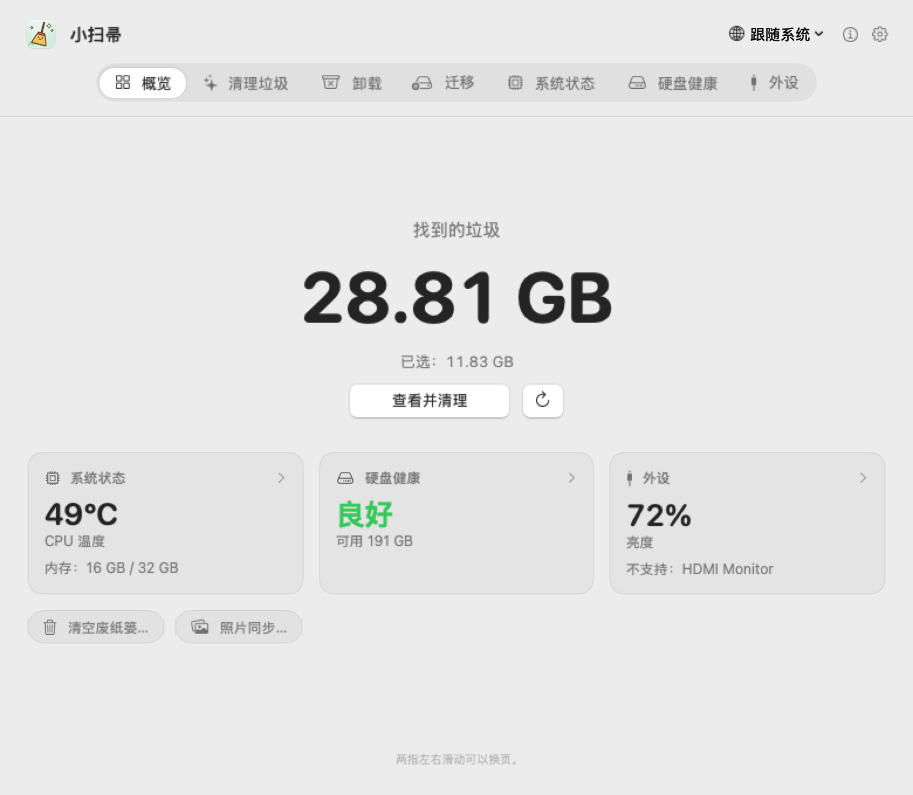
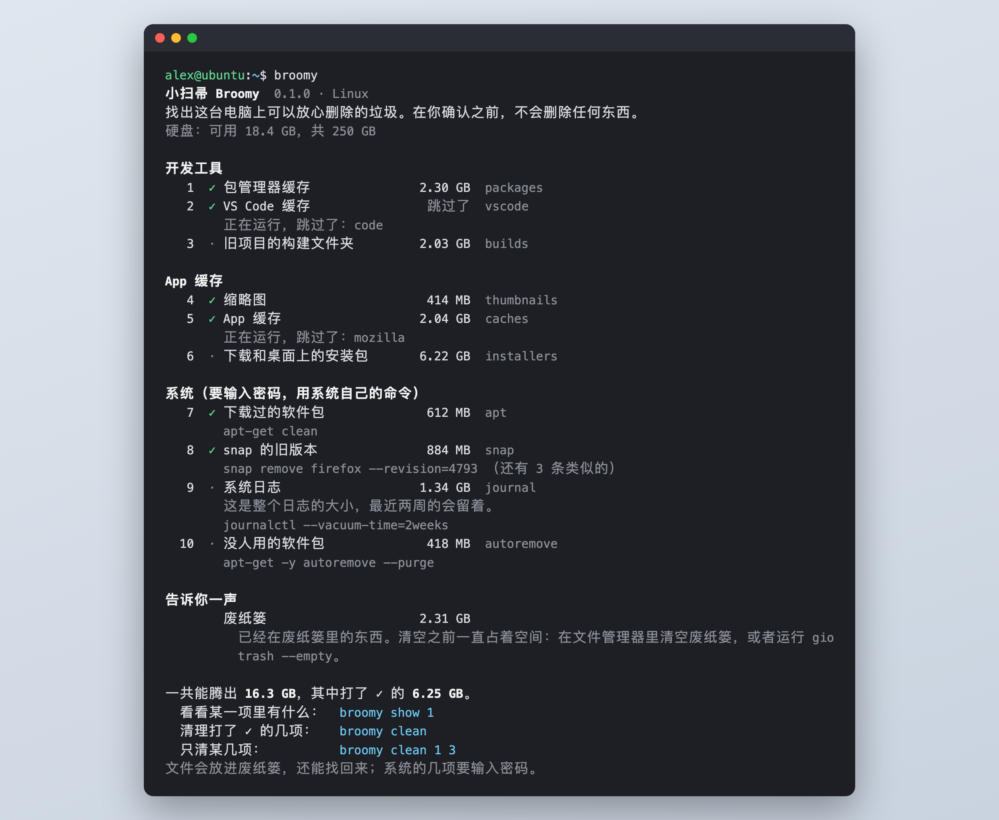
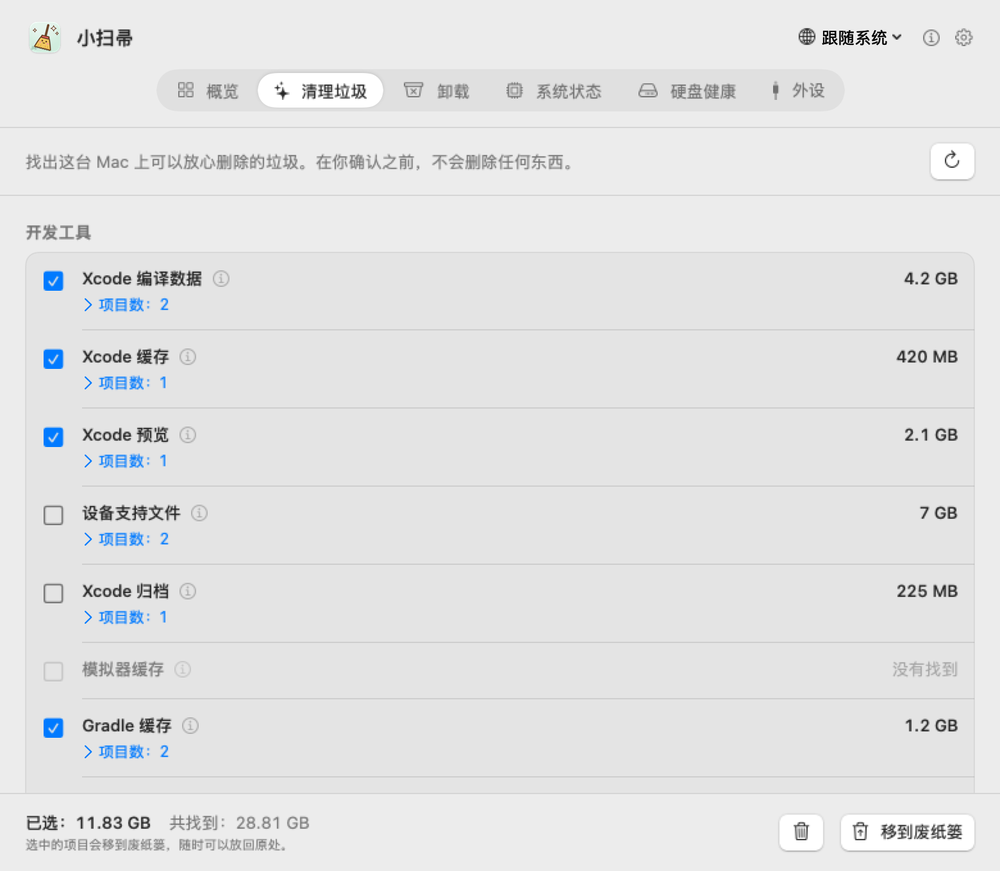
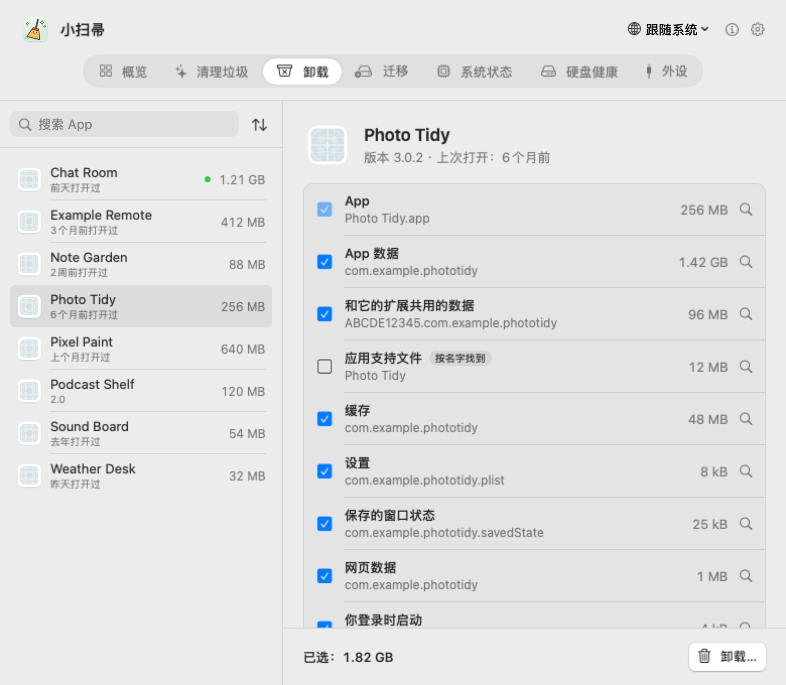
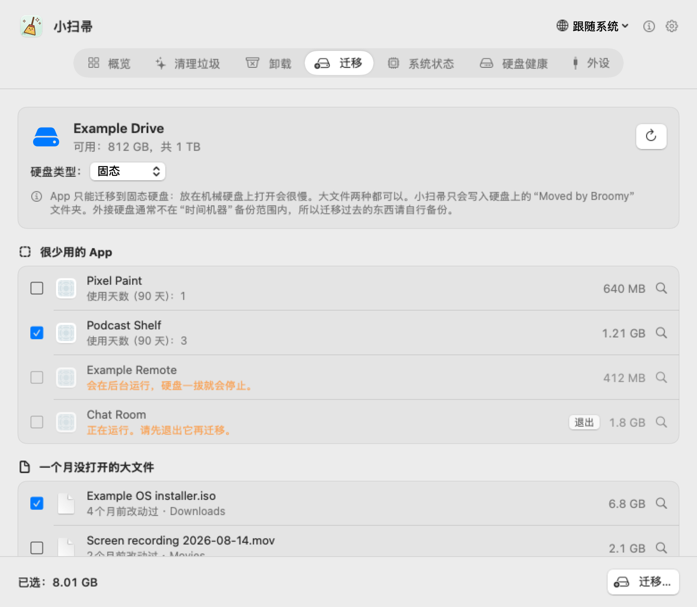
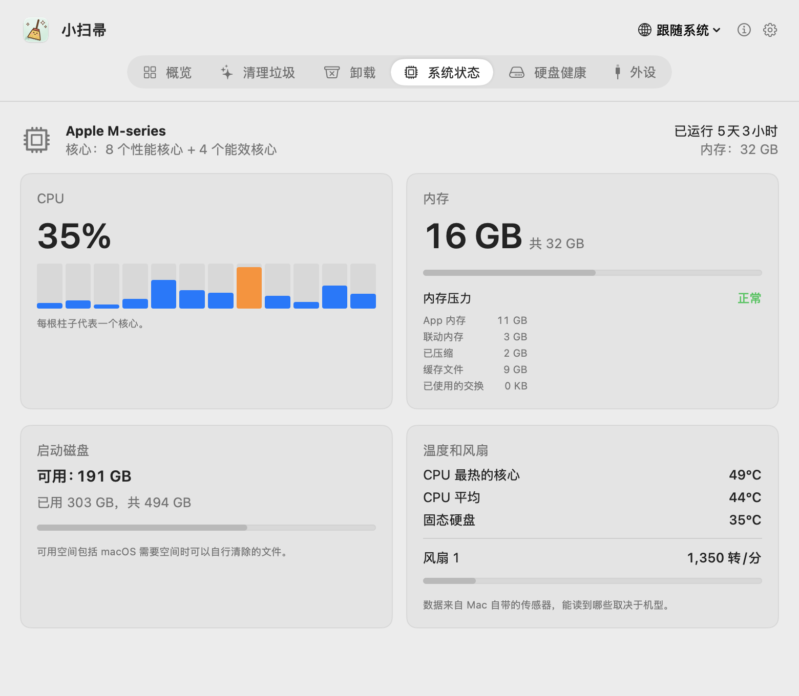
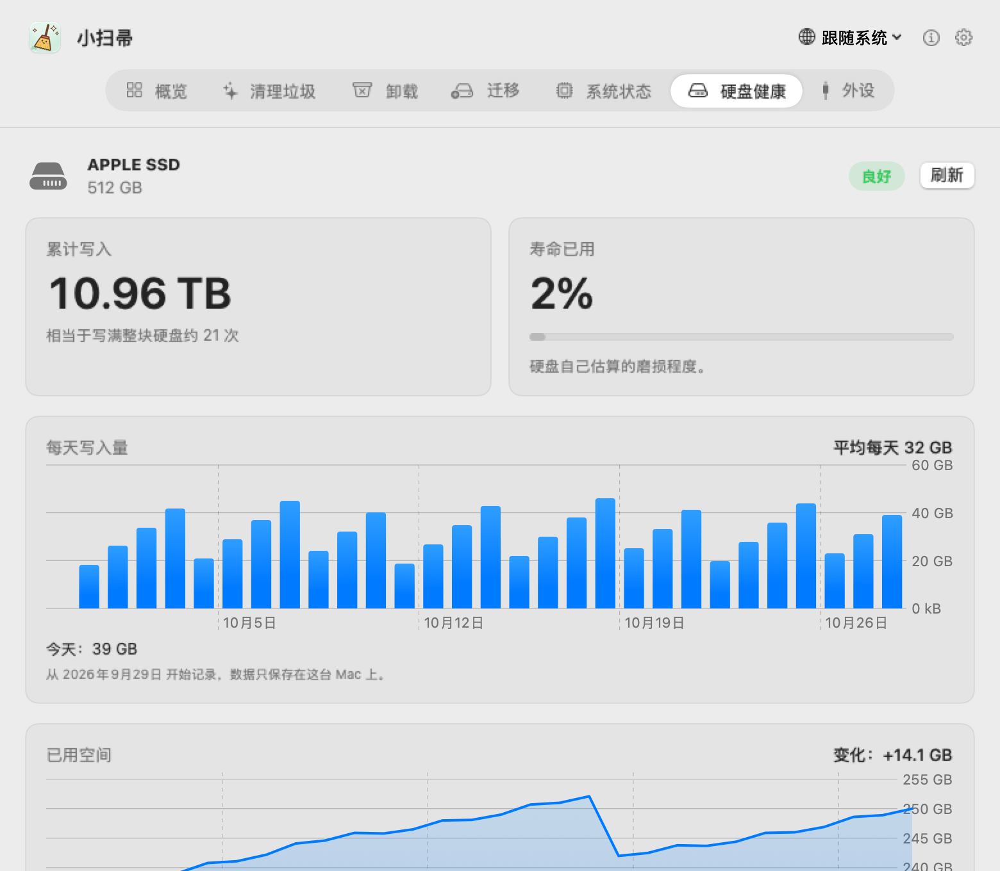
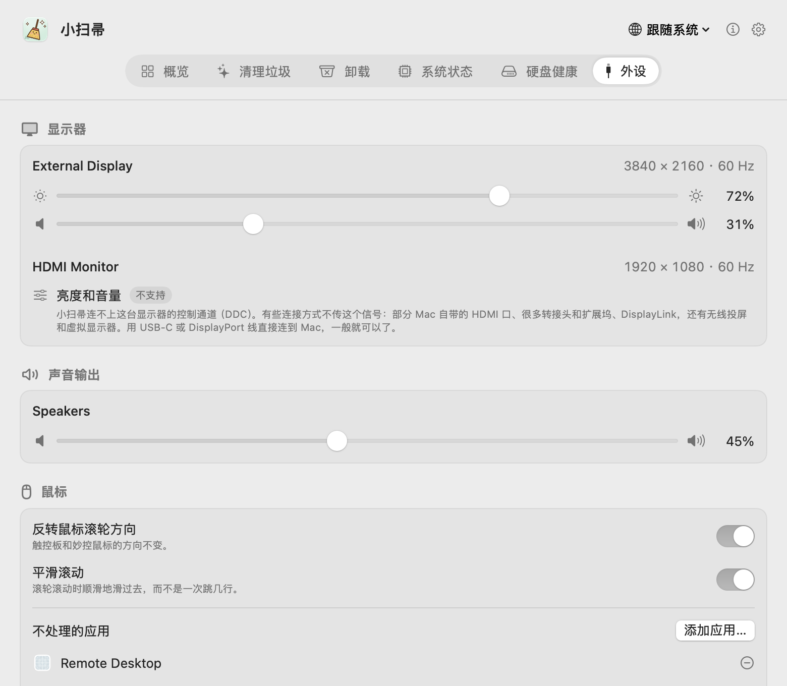

# 小扫帚（Broomy）

[English](README.md) · **简体中文** · [繁體中文](README.zh-TW.md) · [日本語](README.ja.md) · [한국어](README.ko.md) · [Español](README.es.md) · [Français](README.fr.md)

一个小而老实的 Mac 清理工具。小扫帚找出可以放心删除的东西，卸载 App 时连它留下的东西一起带走，顺便看着 Mac 的温度、硬盘健康和显示器。在你确认之前什么都不删，删的东西也都先进废纸篓。免费，没有广告，从不联网。

  

## 下载

**[Broomy 1.2](https://github.com/techinfo-apps/Broomy/releases/latest)**：需要 macOS 14 及以上，Apple 芯片和 Intel 都行。打开 .dmg，把小扫帚拖进“应用程序”。

这个 App 还没经过苹果公证，第一次打开时 macOS 会拦一下。macOS 14：**右键点小扫帚 → 打开 → 打开**。macOS 15 及以后：先打开一次，再到**系统设置 → 隐私与安全性**，往下翻，点小扫帚旁边的**仍要打开**。

只从这里的 [Releases](https://github.com/techinfo-apps/Broomy/releases) 或官网 https://techinfo-apps.github.io/ 下载小扫帚。Releases 页面上每个文件都标着 SHA-256，可以核对下载的文件没被改过。

每个版本加了什么：[版本记录](CHANGELOG.zh-CN.md)。

### Linux

**[小扫帚 Linux 版 0.1.0](https://github.com/techinfo-apps/Broomy/releases/tag/linux-v0.1.0)** 是终端里的一个命令 `broomy`。64 位的 Linux（x86_64 或 ARM）都能直接用，不用另外装任何东西。

Ubuntu、Debian 和它们的兄弟们：

    wget https://github.com/techinfo-apps/Broomy/releases/download/linux-v0.1.0/broomy_0.1.0_amd64.deb
    sudo apt install ./broomy_0.1.0_amd64.deb
    broomy

（ARM 电脑换成 `broomy_0.1.0_arm64.deb`。）别的 Linux：下载 `broomy-0.1.0-linux-amd64`（或 `-arm64`），`chmod +x` 以后直接运行。

`broomy` 只看、只列：缓存、旧项目的构建文件夹、“下载”里的安装包、snap 的旧版本、下载过的软件包和日志。`broomy show 3` 看某一项里有什么，`broomy clean` 问过你以后清理打了 ✓ 的几项。你的文件放进废纸篓，文件管理器里能还原；系统的几项用系统自己的命令，会问你密码。从不联网。

## 一页一个功能

两指左右滑动、点顶部的页签，或者按 ⌘1…⌘7 换页。

### 清理垃圾

找出可以放心删除的垃圾，动手之前把每一样是什么都写清楚。

- **开发工具**：Xcode 的构建数据、缓存、设备支持文件、归档和模拟器；Gradle、Homebrew 的下载；pip、npm、pnpm、Yarn、Bun、CocoaPods、Swift Package Manager、Go、Cargo 的缓存；30 天没人改过的项目里的构建文件夹（node_modules、.build、target、dist、Gradle 的 build），git 跟踪的东西一律不动。
- **App 缓存和日志**，还有留在“下载”和桌面上的安装包。
- **已删除 App 的残留**：App 删掉了，它的登录项和后台服务还在，macOS 一遍遍地想启动它们。系统文件夹里的那些，移除时会用 macOS 自己的对话框问一次密码。

值得多看一眼的（设备支持文件、归档、模拟器、安装包、旧项目的构建文件夹）默认不勾。

  

### 卸载

卸载一个 App 时，连它的容器、缓存、设置、应用支持文件、窗口状态、网页数据和登录项一起移走，每一样都写着大小。按 App 的标识（和它里面的助手程序的标识）去找；只是名字一样的文件夹会列出来，但不勾。苹果的 App 不列；正在运行的要先退出；别的 App 共用的文件不动；App 本身要是移不走，别的也都不动。

  

### 迁移到外接硬盘

很少用的 App、一个月没打开的大文件，可以放到外接硬盘上，想用的时候随时迁回来。小扫帚列出 100 MB 以上的 App，写着最近 90 天用过几天；还有“下载”“桌面”“文稿”“影片”里 500 MB 以上、30 天没打开也没改过的文件。你不勾选、不确认清单，什么都不会动。

每一样先拷到硬盘上的“Moved by Broomy”文件夹，再跟原件比对（文件、大小、内容，App 还要验签名），都对上了原件才进废纸篓；App 会在原位置留一个链接，照样能打开（原来在程序坞里的，要重新拖进去）。任何一步不对，拷贝删掉，原件留在原处。**迁回**也是同样的步骤，反过来走。

App 只放固态硬盘：放在机械硬盘上打开会很慢，所以机械硬盘只放文件；系统说不出是哪种硬盘时，由你来选。硬盘要是 APFS 或 Mac OS 扩展格式。App Store 装的、安装器装的、会在后台运行的、正在运行的 App 留在原处，都写着原因。第一次迁移 App 时，macOS 可能要你在“系统设置”的“App 管理”里允许小扫帚。外接硬盘通常不在“时间机器”备份范围内；清空废纸篓之后，空间才真正腾出来。

  

### 系统状态和硬盘健康

每个核心的 CPU 占用、内存和内存压力、启动磁盘空间、CPU 和固态硬盘的温度、风扇转速。内置固态硬盘：总共写了多少、硬盘自己估计的磨损、错误计数，都是直接从硬盘读的；还有最近 30 天每天写入多少、已用空间怎么变。

  
  

### 外设

调显示器的亮度和音量，外接显示器也行（走 DDC）。调不了的会直说：不支持、为什么、可以试试什么。还有声音输出的音量、更顺手的鼠标滚轮（反转方向、平滑滚动），以及外接硬盘、USB 和雷雳设备。

  

### 菜单栏

愿意的话，小扫帚可以常驻菜单栏：扫把图标旁边显示垃圾大小或 CPU 温度，再加一个小太阳，点一下就能调亮度和音量。

## 隐私

- **从不联网。** 小扫帚里没有任何联网的代码；仅有的链接（这个页面、邮箱）都是你点了才在浏览器或邮件里打开。
- 什么都不收集，什么都不往外发。记录（每天写入、已用空间）只留在这台 Mac 上；“记下每个 App 在哪几天打开过”也一样，默认关着，在设置里打开了才记。
- 在外接硬盘上只动自己的“Moved by Broomy”文件夹，而且要你确认挪哪些；也从不显示序列号。
- 移走的东西都进废纸篓，清空之前随时可以放回去。

## 语言

English、简体中文、繁體中文、日本語、한국어、Español、Français、Русский、हिन्दी。翻译有不对的地方，欢迎写信告诉我们（地址在下面）。

## 反馈

techinfor404@gmail.com，或者在这里提 issue。

小扫帚免费使用，源代码不公开。

---

**永远免费，永远没有广告。** 只做小而美的软件和小游戏。免费，无广告，守护你的隐私——数据只留在你自己的设备上。

联系：techinfor404@gmail.com · 官网：https://techinfo-apps.github.io/

 请作者喝咖啡

自愿的，不请也一样用。每一杯咖啡，都会变成下一次更新。

