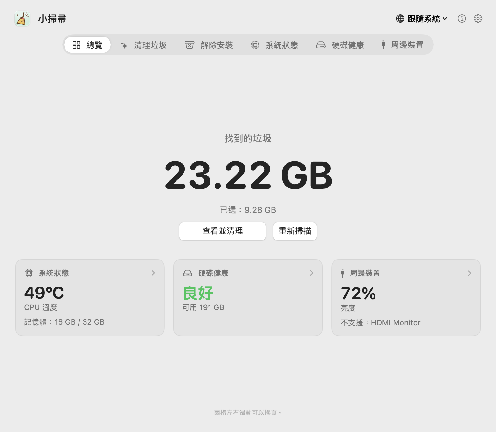
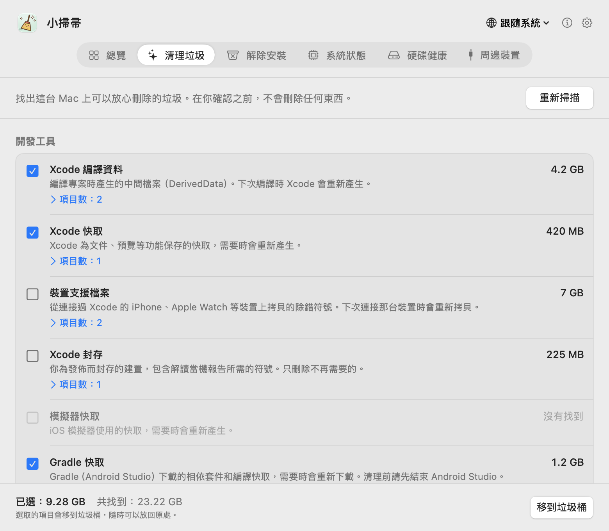
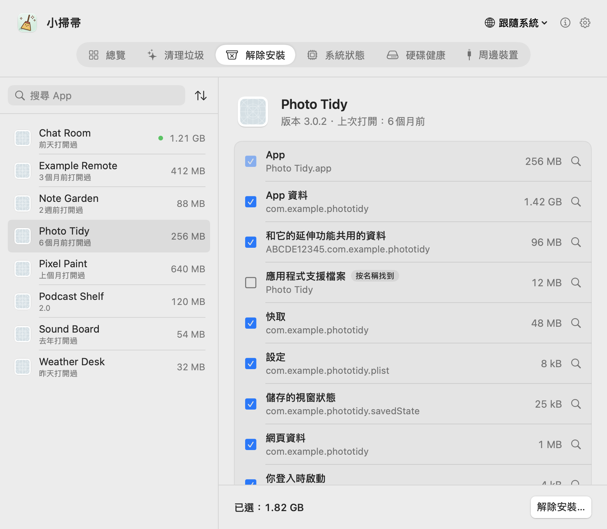
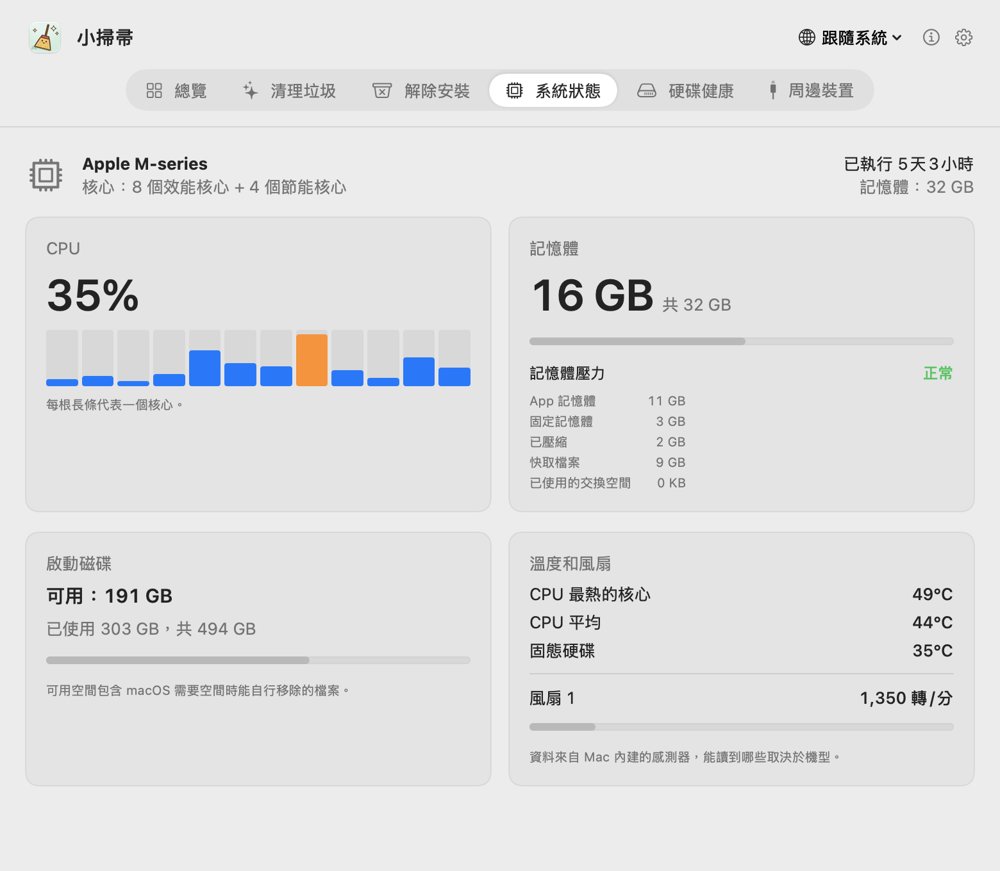
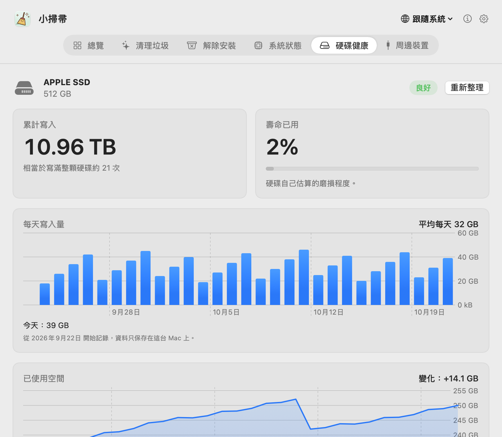
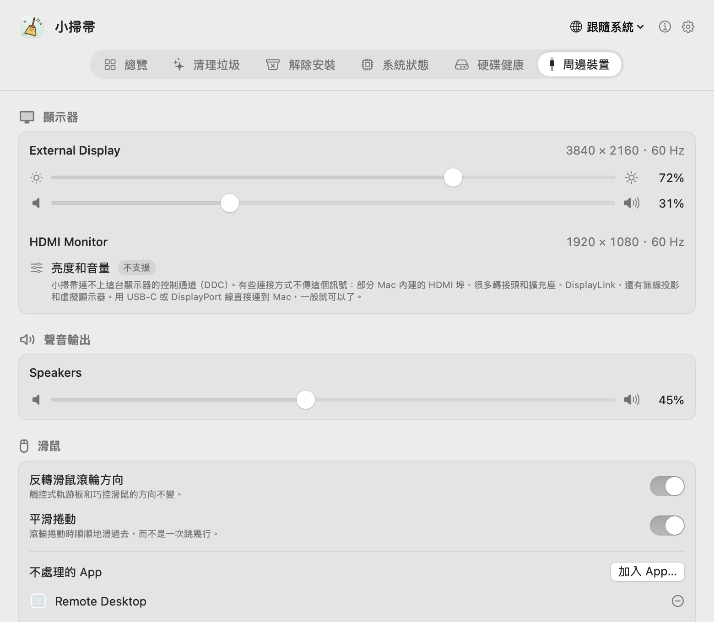

# 小掃帚（Broomy）

[English](README.md) · [简体中文](README.zh-CN.md) · **繁體中文** · [日本語](README.ja.md) · [한국어](README.ko.md) · [Español](README.es.md) · [Français](README.fr.md)

一個小而老實的 Mac 清理工具。小掃帚找出可以放心刪除的東西，解除安裝 App 時連它留下的東西一起帶走，順便看著 Mac 的溫度、硬碟健康和顯示器。在你確認之前什麼都不刪，刪的東西也都先進垃圾桶。免費，沒有廣告，從不連網。

  

## 下載

**[Broomy 1.0](https://github.com/techinfo-apps/Broomy/releases/latest)**：需要 macOS 14 以上，Apple 晶片和 Intel 都可以。打開 .dmg，把 小掃帚拖進「應用程式」。

這個 App 還沒經過 Apple 公證，第一次打開時 macOS 會擋一下。macOS 14：**按右鍵點小掃帚 → 打開 → 打開**。macOS 15 及以後：先打開一次，再到**系統設定 → 隱私權與安全性**，往下捲，點 小掃帚旁邊的**強制打開**。

只從這裡的 [Releases](https://github.com/techinfo-apps/Broomy/releases) 或官網 https://techinfo-apps.github.io/ 下載 小掃帚。Releases 頁面上每個檔案都標著 SHA-256，可以核對下載的檔案沒被改過。

每個版本加了什麼：[版本紀錄](CHANGELOG.zh-TW.md)。

## 一頁一個功能

兩指左右滑動、點頂部的頁籤，或按 ⌘1…⌘6 換頁。

### 清理垃圾

找出可以放心刪除的垃圾，動手之前把每一樣是什麼都寫清楚。

- **開發工具**：Xcode 的建置資料、快取、裝置支援檔案、封存和模擬器；Gradle、Homebrew 的下載；pip、npm、pnpm、Yarn、Bun、CocoaPods、Swift Package Manager、Go、Cargo 的快取；30 天沒人改過的專案裡的建置檔案夾（node_modules、.build、target、dist、Gradle 的 build），git 追蹤的東西一律不動。
- **App 快取和日誌**，還有留在「下載」和桌面上的安裝檔。
- **已刪除 App 的殘留**：App 刪掉了，它的登入項目和背景服務還在，macOS 一遍又一遍地想啟動它們。系統檔案夾裡的那些，移除時會用 macOS 自己的對話框問一次密碼。

值得多看一眼的（裝置支援檔案、封存、模擬器、安裝檔、舊專案的建置檔案夾）預設不勾。

  

### 解除安裝

解除安裝一個 App 時，連它的容器、快取、設定、應用程式支援檔案、視窗狀態、網頁資料和登入項目一起移走，每一樣都寫著大小。依 App 的識別碼（和它裡面輔助程式的識別碼）去找；只是名稱一樣的檔案夾會列出來，但不勾。Apple 的 App 不列；正在執行的要先結束；別的 App 共用的檔案不動；App 本身若移不走，其他的也都不動。

  

### 系統狀態和硬碟健康

每個核心的 CPU 使用率、記憶體和記憶體壓力、啟動磁碟空間、CPU 和固態硬碟的溫度、風扇轉速。內建固態硬碟：總共寫了多少、硬碟自己估計的磨損、錯誤計數，都是直接從硬碟讀取；還有最近 30 天每天寫入多少、已用空間怎麼變。

  
  

### 周邊裝置

調整顯示器的亮度和音量，外接顯示器也可以（透過 DDC）。調不了的會直說：不支援、為什麼、可以試試什麼。還有聲音輸出的音量、更順手的滑鼠滾輪（反轉方向、平滑捲動），以及外接硬碟、USB 和 Thunderbolt 裝置。

  

### 選單列

願意的話，小掃帚可以常駐選單列：小掃把旁邊顯示垃圾大小或 CPU 溫度，再加一個小太陽，點一下就能調亮度和音量。

## 隱私

- **從不連網。** 小掃帚裡沒有任何連網的程式碼；僅有的連結（這個頁面、信箱）都是你點了才在瀏覽器或郵件裡打開。
- 什麼都不收集，什麼都不往外送。紀錄（每天寫入、已用空間）只留在這台 Mac 上。
- 從不讀取外接硬碟裡的內容，也從不顯示序號。
- 移走的東西都進垃圾桶，清空之前隨時可以放回去。

## 語言

English、简体中文、繁體中文、日本語、한국어、Español、Français、Русский、हिन्दी。翻譯有不對的地方，歡迎寫信告訴我們（地址在下面）。

## 意見回饋

sublueai@gmail.com，或在這裡開 issue。

小掃帚免費使用，原始碼不公開。

---

**永遠免費，永遠沒有廣告。** 只做小而美的軟體和小遊戲。免費，無廣告，守護你的隱私——資料只留在你自己的裝置上。

聯絡：sublueai@gmail.com · 官網：https://techinfo-apps.github.io/

 請作者喝咖啡

自願的，不請也一樣用。每一杯咖啡，都會變成下一次更新。

